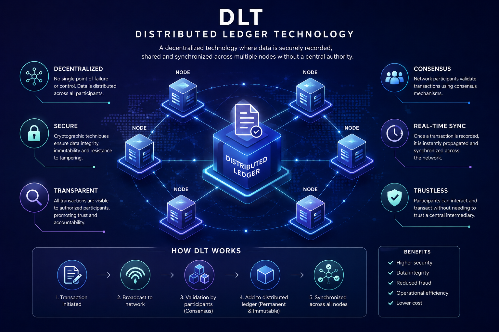

# Distributed Ledger Technology (DLT): What Is a Distributed Ledger?

## Introduction

Distributed Ledger Technology (DLT) is a technology for recording, storing, and sharing data across multiple computers or participants in a network.

Unlike a traditional centralized database, where a single organization usually controls the main copy of the data, a distributed ledger is maintained across multiple participants.

Blockchain is one of the best-known types of DLT, but **DLT and blockchain are not exactly the same thing**. Blockchain is a specific way of implementing a distributed ledger.

Understanding DLT is important because it provides the broader technological foundation behind many decentralized systems.

## What Is a Ledger?

A ledger is a record of transactions or changes in data.

For example, a traditional bank maintains a ledger containing information such as:

* Account balances
* Deposits
* Withdrawals
* Transfers
* Transaction history

In a traditional system, the bank controls the central database and is responsible for maintaining its correctness.

A distributed ledger changes this architecture by distributing the record across multiple participants.

## What Is a Distributed Ledger?

A distributed ledger is a shared record of data that is maintained and synchronized across multiple independent computers or network participants.

Instead of relying on a single central database, multiple participants maintain copies or portions of the ledger.

When a new transaction or state change occurs, the network follows a defined protocol to determine whether the change is valid and how the ledger should be updated.

In simplified form:

**Transaction → Verification → Agreement → Ledger Update**

The exact process depends on the specific DLT system.

## Centralized vs. Distributed Ledgers

A centralized ledger typically has one main authority responsible for maintaining the database.

For example:

**Users → Bank → Central Database**

The bank receives transactions, verifies them, updates the database, and provides the resulting information to its users.

A distributed ledger can instead be represented as:

**Participant A ↔ Participant B ↔ Participant C ↔ Participant D**

Multiple participants communicate with each other and maintain synchronized information according to the rules of the network.

This can reduce dependence on a single central authority.

## How Does DLT Work?

Although different DLT systems use different architectures, a simplified process can look like this:

### 1. A Transaction Is Created

A participant creates a transaction or proposes a change to the shared state.

For example:

**Alice → Bob: 5 tokens**

### 2. The Transaction Is Broadcast

The transaction is sent to other participants in the network.

### 3. The Transaction Is Verified

Network participants check whether the transaction follows the system's rules.

Depending on the DLT, verification may include checking:

* Digital signatures
* Account balances
* Transaction validity
* Authorization
* Double-spending conditions
* Other protocol rules

### 4. The Network Reaches Agreement

The network uses a consensus or agreement mechanism to determine which valid transactions should be accepted.

Different DLT systems can use different mechanisms.

### 5. The Ledger Is Updated

Once the transaction is accepted, the relevant participants update their ledger or state.

The result is that the network maintains a consistent view of the system.

## DLT and Consensus

Consensus is an important part of many distributed ledger systems.

Because multiple computers are maintaining shared information, the network needs a method for determining which changes are valid and what the current state of the ledger should be.

Different systems can use different consensus mechanisms, including:

* Proof of Work (PoW)
* Proof of Stake (PoS)
* Byzantine Fault Tolerant mechanisms
* Other agreement protocols

Consensus does not simply mean that every computer votes on every transaction. The exact mechanism depends on the architecture and protocol of the DLT.

## DLT vs. Blockchain

One of the most important distinctions is:

**Blockchain is a type of DLT, but not every DLT is a blockchain.**

A blockchain typically organizes transactions into blocks and links those blocks together using cryptographic hashes.

A simplified blockchain structure is:

**Block → Block → Block → Block**

Each block contains information related to previous blocks, creating a chronological chain.

DLT is a broader concept. A distributed ledger does not necessarily need to organize data into blocks or create a traditional blockchain structure.

Therefore:

**DLT = Broader Technology**

**Blockchain = One Type of DLT**

## Important Characteristics of DLT

### Distribution

The ledger is maintained across multiple participants rather than relying entirely on one central database.

### Synchronization

Participants follow a protocol to keep their views of the ledger or state synchronized.

### Cryptography

Many DLT systems use cryptographic techniques to provide security, authentication, integrity, and authorization.

### Consensus or Agreement

Distributed systems generally require mechanisms for participants to agree on accepted changes or the current state.

### Transparency

Depending on the design, participants may be able to independently verify transactions or ledger updates.

However, not every DLT provides complete public transparency. Some DLT systems are private or permissioned.

## Permissionless vs. Permissioned DLT

DLT systems can have different access models.

### Permissionless DLT

Anyone who satisfies the protocol's requirements may be able to participate in the network.

Public blockchain networks such as Bitcoin and Ethereum are examples of permissionless distributed systems.

### Permissioned DLT

Participation is restricted to approved organizations or participants.

Permissioned systems are often considered for business environments where organizations need controlled access to the network.

Therefore, decentralization and permissionlessness are related concepts, but they are not identical.

## DLT and Decentralization

DLT can reduce reliance on a single central authority, but **not every distributed ledger is equally decentralized**.

A system may distribute its database across many computers while still being controlled by a small number of organizations.

Therefore, when evaluating a DLT, it is important to consider:

* Who controls the network?
* Who can participate?
* Who can validate transactions?
* Who can modify the protocol?
* How many independent participants maintain the system?
* How is agreement reached?

These questions help determine the actual level of decentralization.

## Advantages of DLT

DLT can provide several potential advantages.

### Reduced Single Point of Failure

Because information is distributed across multiple participants, the system may be less dependent on one server or organization.

### Shared Source of Truth

Participants can maintain a synchronized record rather than relying on separate databases that must constantly be reconciled.

### Auditability

Depending on the system, historical changes can be easier to verify and audit.

### Cryptographic Security

Cryptographic mechanisms can provide strong guarantees about authorization and data integrity.

### Reduced Intermediaries

Some DLT systems can allow participants to interact directly without requiring a traditional central intermediary for every operation.

## Limitations of DLT

DLT is not a solution to every database problem.

Distributed systems can introduce challenges such as:

* Network latency
* Consensus overhead
* Scalability limitations
* Storage requirements
* Complex system design
* Governance challenges
* Privacy concerns

For some applications, a traditional centralized database can be faster, simpler, and more efficient.

The choice between centralized and distributed architectures depends on the requirements of the system.

## DLT in Blockchain Systems

Blockchain networks use distributed ledger concepts to maintain shared states.

For example, in a blockchain network, many nodes maintain information about the blockchain and independently verify data according to the protocol.

When a valid transaction changes the state of the network, participants eventually update their view of that state.

This creates an important relationship:

**Transactions → Execution → State Transition → Shared Ledger/State**

The exact implementation differs between blockchain networks.

## Real-World Applications

DLT can be used in various areas, including:

* Digital currencies
* Payments
* Supply chain tracking
* Asset management
* Trade finance
* Digital identity
* Cross-organizational record keeping
* Tokenized assets
* Decentralized applications

The technology is particularly useful when multiple organizations need to share records but do not want to rely entirely on a single party to maintain the system.

## DLT vs. Traditional Database

The main difference can be understood without a table.

In a **traditional database**, one organization usually controls the database. For example, a bank can control its own database and decide who can read or modify the records.

In a **distributed ledger**, multiple participants maintain and synchronize the shared record according to the rules of the network.

Traditional databases are generally optimized for performance, simplicity, and centralized management. DLT systems often prioritize shared verification, coordination, and reducing dependence on a single authority.

This comparison is simplified because real-world systems can combine centralized and distributed components.

## Conclusion

Distributed Ledger Technology is a broad approach to maintaining shared records across multiple participants in a network.

Instead of depending entirely on one central database, DLT allows multiple participants to maintain and synchronize information according to predefined rules.

Blockchain is one specific implementation of distributed ledger technology, but DLT is a broader concept that includes other distributed architectures.

The key idea to remember is:

**DLT is about distributing and coordinating a shared ledger or state among multiple participants.**

Understanding DLT provides an important foundation for understanding blockchain architecture, consensus mechanisms, distributed systems, and decentralized networks.
