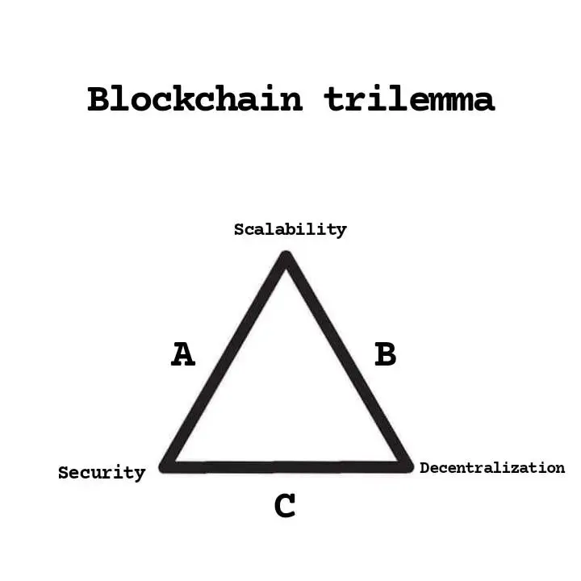

# What Is the Blockchain Triangle? Features of a Blockchain

**Originally published on Medium by Ali Sultanalizadeh.**

## The Blockchain Trilemma

The blockchain trilemma describes the challenge of balancing three important properties in a blockchain system: decentralization, security, and scalability. Improving one property can create trade-offs that affect the others, depending on the network's design.

### Decentralization

Decentralization means that control and validation are distributed among multiple independent participants rather than concentrated in a single authority. A highly decentralized network can be harder for one organization to control, but coordinating many independent nodes may add overhead.

### Security

Security is a blockchain's ability to resist attacks, protect the integrity of its state, and ensure that invalid transactions are rejected. It depends on several factors, including consensus design, cryptography, economic incentives, and the distribution of network participants.

### Scalability

Scalability describes a network's ability to process more transactions and support more users while maintaining acceptable costs and performance. Increasing throughput can introduce design trade-offs, such as requiring more powerful hardware or relying on additional layers.

## Why Is It Called a Trilemma?

The three goals can pull a protocol in different directions. For example, increasing the number of transactions each node must process may raise hardware requirements and make it harder for more people to run nodes. That can affect decentralization. Protocol designers therefore make trade-offs and explore approaches such as more efficient consensus, rollups, and data-availability improvements.

The trilemma is a useful way to think about design constraints, not a universal mathematical proof that every blockchain must sacrifice exactly one property. The actual trade-offs depend on the protocol and how its properties are measured.

---

**Source:** [What Is the Blockchain Triangle? Features of a Blockchain — Medium](https://medium.com/@0xsix9/what-is-the-blockchain-triangle-features-of-a-blockchain-db628ce19ef6)
