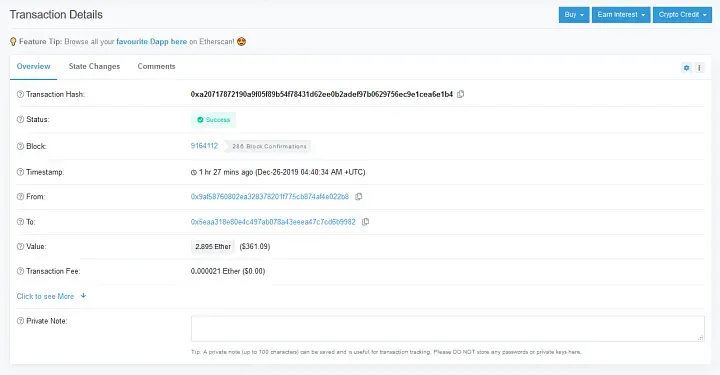

# What is the Blockchain Triangle? Features of a Blockchain

**Author:** [Ali Sultanalizadeh](https://medium.com/@0xsix9)  
**Originally published:** November 20, 2025 · 4 min read  
**Source:** [What is the Blockchain Triangle? Features of a Blockchain — Medium](https://medium.com/@0xsix9/what-is-the-blockchain-triangle-features-of-a-blockchain-db628ce19ef6)

## Blockchain Triangle

The blockchain triangle is a triangle made of three vertices: decentralization, security, and scalability.

It is like this that if security and scalability increase, one of its other vertices, i.e. its decentralization, decreases, so if one of the two vertices increases, the other vertex or the third vertex decreases.

**Blockchain is an innovative technology that acts as a distributed and decentralized database. This technology has attracted attention in many industries due to its special features and benefits. Next, I will explain the main features and challenges of blockchain, including decentralization, scalability, and security.**

## Features of Blockchain

### Scalability

Scalability is the ability of a blockchain network to process a large number of transactions per second and support a large number of users.

### The Challenge of Scalability of Blockchain Networks

With the increase in the number of users and the number of transactions, the speed of the network decreases and the cost of transactions on the network increases. The importance of scalability is essential for the widespread adoption of blockchains.

### Decentralization

In blockchain, data is distributed among a network of nodes (nodes) and there is no central authority to control the data. This feature increases transparency and reduces the risk of fraud. Users can easily access information and this information is publicly visible.

### Transparency and Traceability

Every transaction is permanently recorded in the blockchain and is visible to all members of the network. This feature allows users to track transactions and ensure their authenticity.

What I am saying is that blockchain is transparent and all transactions are traceable, while **public blockchains** have this capability and **private blockchains** do not have this transparency and are not visible to everyone. You may be wondering how we can track the details of these transactions. Every blockchain has a probe where you can see transaction information. For this, when you record a transaction in the blockchain, a **TXN hash** is created from the transaction you recorded in a blockchain. By copying it, you can search for that network in the **Explorer** and find the transaction information.

## You may be Wondering what (Transaction Hash) or (TXN Hash) is

A long, unique string of letters and numbers assigned to each transaction in a blockchain makes these transaction hashes traceable.

## An example of the Ethereum network, where we found transaction information on the Ethereum blockchain network using the Explorer of this network with the transaction hash

### Transaction information

Transaction information includes the date of the transaction, in which block this transaction was made, from which address to the destination address, how much the network fee was paid, and other information.

### Security

Blockchain uses cryptographic techniques to protect data, which makes it very difficult to change or delete recorded information. Considering that each block is related to its previous block, changing information in one block requires changing all subsequent blocks, which is almost impossible.

### Consensus

Consensus refers to the methods that nodes use to confirm transactions and add new blocks to the chain. There are various **algorithms** to achieve consensus, including **proof-of-work** and **proof-of-stake**, thereby ensuring network security.

### Immutability

Once a transaction is recorded in the blockchain, it cannot be easily changed. This feature increases trust in the system.

## The Security Challenge of a Blockchain

### 1. Security

Although blockchain itself is strong in terms of security, it still has threats such as 51%, where one entity can gain control of more than half of the computing power and alter transactions.

**Tip:** In the consensus method, there is proof of work of these attacks, but it is not possible in the consensus method.

### 2. Legal and Regulatory Issues

Due to its decentralized nature, blockchain faces legal and regulatory challenges. Governments may not be able to easily monitor blockchain activities and this could lead to illegal uses.

### 3. Energy Consumption

Some blockchains, especially those that use consensus algorithms like Proof of Work, require high energy consumption, which can lead to environmental concerns.

## Conclusion

As an innovative technology, blockchain has many features and benefits that can help improve various systems. But the existing challenges, especially in the field of scalability and security, require further research and development to fully realize the potential of this technology.
