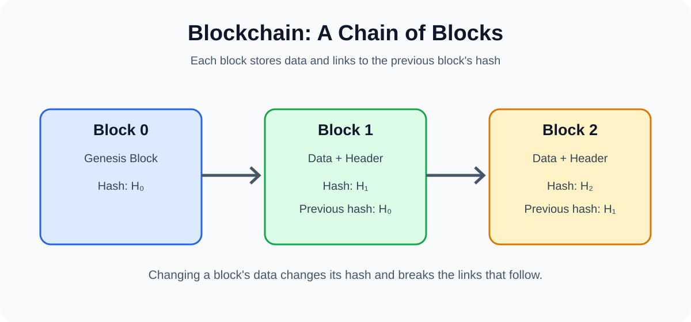

# What is a Blockchain?

> Originally published on Medium by Ali Sultanalizadeh on November 19, 2025. This repository copy preserves the article text; the diagram above is a local recreation because the original embedded image could not be extracted as a standalone file.

[Read the original article on Medium](https://medium.com/@0xsix9/what-is-a-blockchain-cfb1a14842eb)

## First, let’s have a simple definition of blockchain

Blockchain is a chain of blocks, each block contains a set of data. These blocks are sequentially connected to each other and form a chain. Each block contains information such as transactions, time and a unique hash from the previous block.

## Block

Blocks are the basic units of information in the blockchain. Each block contains a set of data, header and hash. Data usually includes transactions or other information. The header contains information such as when the block was created, the hash of the previous block, and more.

## Chain

A chain refers to a set of blocks that are connected sequentially. Each new block is connected to the previous block and this connection is done by the hash of the previous block. This chain structure makes the change of information in one block affect all subsequent blocks and this feature increases the security of the blockchain.

## Genesis Block

The genesis block or block zero is the first block in any blockchain. This block is the foundation of the entire chain of blocks and all other blocks are connected to it. Because it is the first block, it has no previous blocks and the hash of the previous block is zero or empty.

## Hash

A hash is a mathematical function that converts data inputs into a fixed and unique string of characters. Each block has a unique hash that acts as an identifier for that block. A change in the block data will cause a change in the hash of that block.

## Node

Nodes are computers that participate in the blockchain network. Each node stores a copy of the blockchain chain and can help verify and process transactions. Nodes can be divided into two types: full nodes, which store the entire history of the blockchain, and light nodes, which store only parts of the blockchain.

## Consensus

Consensus refers to the methods that nodes use to confirm transactions and add new blocks to the chain. There are various algorithms for achieving consensus, including Proof of Work and Proof of Stake.

---

**Source:** [What is a Blockchain? — Medium](https://medium.com/@0xsix9/what-is-a-blockchain-cfb1a14842eb)
