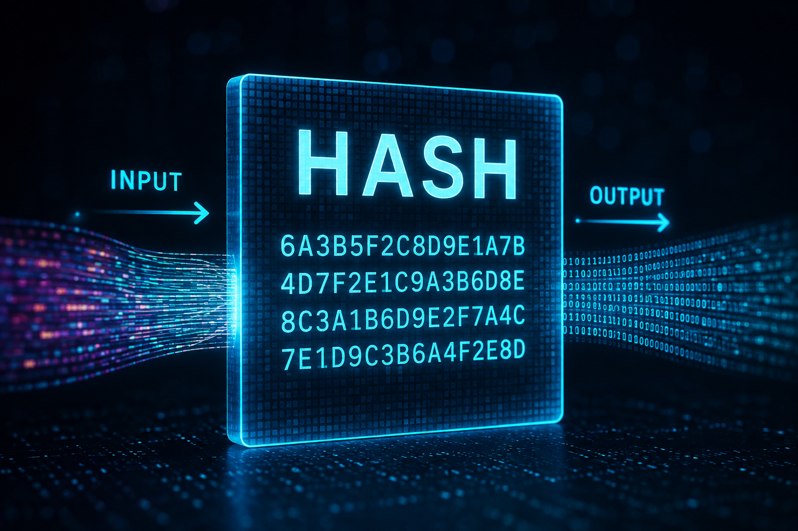

# Hash — The Foundation of Blockchain Security

## What Is a Hash?

A **Hash** is a mathematical function that takes any input — no matter how small or large (a single word, an entire book, or a multi-gigabyte file) — and converts it into an output of a **fixed size**.

Simple example:

```
Hash("Ali") = 0x8f14e45f...
Hash("This is a very long text with thousands of words...") = 0xa3f2c891...
```

It doesn't matter how short or long the input is — the output is always a string of the same fixed length (for example, in Keccak-256, it's always 32 bytes, or 64 hexadecimal characters).

## Four Key Properties of a Good Hash Function

### 1. One-Way (Irreversible)

Given the output of a hash, it is **practically impossible** to recover the original input. You can easily go from `"Ali"` to `0x8f14e45f...`, but there's no way to go backward from `0x8f14e45f...` to `"Ali"` (short of brute-forcing every possible input, which is computationally infeasible).

This property is also called **Preimage Resistance**.

### 2. Deterministic

A given input **always** produces exactly the same output — whether today, a year from now, on your computer, or on someone else's computer on the other side of the world.

```
Hash("Ali") = 0x8f14e45f...   (always, everywhere, the same value)
```

### 3. Extreme Sensitivity to Change (Avalanche Effect)

The smallest possible change in the input — even a single letter or a single bit — causes the output to become **completely different** and unpredictable.

```
Hash("Ali")  = 0x8f14e45f...
Hash("ali")  = 0x2c74fd17...   (only the first letter was lowercased, but the output is entirely different)
```

This property makes it impossible for anyone to make a small edit to data and produce a similar-looking hash.

### 4. Collision Resistance

It is practically impossible to find two different inputs that produce the same hash output:

```
Hash(A) ≠ Hash(B)   for virtually all A ≠ B (with extremely high mathematical confidence)
```

If such a collision were easy to find, the entire security model would collapse — since someone could swap real data for fake data without changing the hash.

## Why Blockchain Simply Doesn't Work Without Hashing

### 1. Linking Blocks Together (Chain Integrity)

Every block stores the full hash of the previous block in its **Parent Hash** field. This means each block is physically and mathematically "locked" to the one before it. If someone tries to alter an old block, its hash changes — and the next block, which references the old hash, is no longer valid. The chain "breaks" from that point forward.

### 2. Summarizing Massive Amounts of Data (Merkle Tree)

A blockchain can't store millions of transactions or accounts directly inside a block header — the size would be unmanageable. Instead, all of this data is compressed into a single 32-byte value using chained hashes (a Merkle Tree) — like State Root or Transactions Root.

### 3. Unique Identifiers for Everything

Transaction hashes, account addresses (derived from hashing a public key), and block identifiers are all built from hashing. This means everything on a blockchain has a unique, reproducible "fingerprint."

### 4. Proof-of-Work

Under Proof-of-Work, miners had to hash millions of different values to find one output with a specific property (e.g., starting with a certain number of zeros). This is hard and expensive to find, but trivially fast to verify — and this exact asymmetry is what makes Proof-of-Work secure.

## A Concrete Example to Make It Click

Imagine you have an important legal document, and you want to be sure no one tampers with it later — without having to store the actual document somewhere secure.

Solution: compute the hash of the document and record just that short hash somewhere (e.g., on a public blockchain).

Later, anyone who has the original document can recompute its hash. If it matches the recorded hash, the document is untouched. If even a single word has changed, the new hash will be completely different, and the tampering is immediately obvious.

This is exactly what blockchain does with every block and every transaction.

## Common Hash Algorithms in Blockchain

| Algorithm | Used In |
|---|---|
| **SHA-256** | Bitcoin |
| **Keccak-256** | Ethereum (block hashing, address generation, Merkle Trees) |
| **RIPEMD-160** | Some address-generation schemes (e.g., Bitcoin) |
| **Blake2/Blake3** | Some newer blockchains (e.g., Zcash, Polkadot) |

## Summary

Hashing is the simplest, yet **most important**, cryptographic tool in the entire blockchain world. Without it:

- Blocks wouldn't be linked together (Parent Hash)
- There would be no secure way to summarize the state of the network (State Root)
- Transactions wouldn't have unique identifiers
- Proof-of-Work mining wouldn't make sense at all

Every time you see a field like **Parent Hash**, **State Root**, **Transactions Root**, or **Receipts Root** in a block header, you're looking at the direct result of this simple — yet incredibly powerful — concept.
