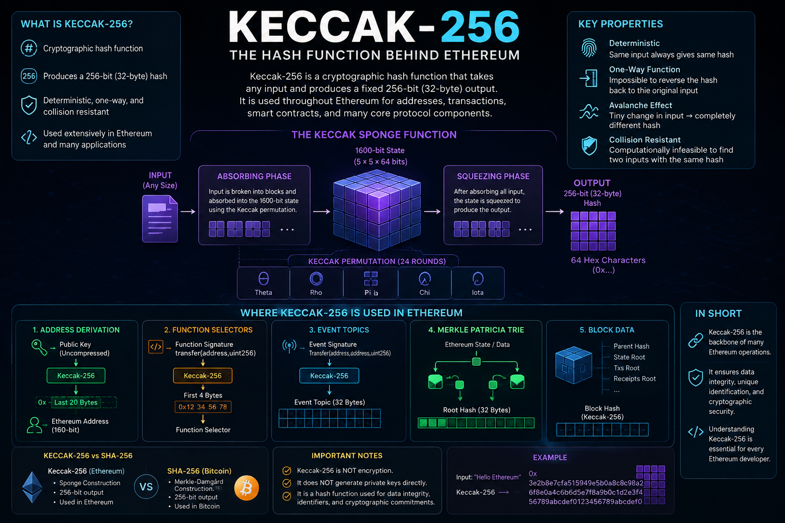

# Keccak-256: The Hash Function Behind Ethereum

**When** learning about blockchain technology, cryptographic hashing is one of the fundamental concepts that every developer should understand.

Ethereum, smart contracts, wallets, transactions, and many other blockchain components rely heavily on cryptographic hash functions.

One of the most important hash functions in the Ethereum ecosystem is **Keccak-256**.

Keccak-256 is used throughout Ethereum for generating hashes, deriving addresses, identifying data, building Merkle Patricia Tries, and creating unique identifiers.

In this article, we will explore what Keccak-256 is, how it works, why Ethereum uses it, and how it differs from SHA-256.

---

## What Is Keccak-256?

**Keccak-256 is a cryptographic hash function that produces a fixed-size 256-bit hash from arbitrary input data.**

Regardless of the size of the input, the output is always exactly **256 bits**, which is:

* 32 bytes
* 64 hexadecimal characters

For example, if we provide the following input:

```text
Hello
```

Keccak-256 produces a deterministic 256-bit output.

If even a single character changes:

```text
Hello!
```

the resulting hash will be completely different.

This property makes Keccak-256 useful for verifying data and creating unique identifiers.

---

## Keccak vs Keccak-256

The name can sometimes be confusing.

**Keccak** is a family of cryptographic hash functions.

Keccak-256 is one specific configuration of that family that produces a 256-bit output.

Ethereum uses **Keccak-256** extensively.

It is also important to understand that Ethereum's Keccak-256 is not exactly the same algorithm as the standardized **SHA3-256** found in the SHA-3 standard.

Although SHA-3 is based on Keccak, the final standard introduced different padding rules.

Therefore:

> Ethereum uses Keccak-256, not standardized SHA3-256.

This distinction is important when implementing Ethereum-related cryptographic operations in software.

---

# How Does Keccak-256 Work?

Keccak-256 belongs to a class of cryptographic constructions called **sponge functions**.

Instead of processing the entire input at once, the algorithm absorbs the input into an internal state and then produces the desired output.

The process can be simplified into two major phases:

1. Absorbing
2. Squeezing

---

## 1. Absorbing Phase

The input data is divided into blocks.

These blocks are gradually incorporated into an internal state.

During this process, the Keccak permutation is repeatedly applied to the internal state.

The permutation mixes the data extensively.

This creates the avalanche effect, where a small change in the input causes a major change in the final output.

---

## 2. Squeezing Phase

After all input data has been absorbed, Keccak begins producing output from its internal state.

For Keccak-256, the algorithm produces:

**256 bits of output.**

The result is then normally represented as hexadecimal characters.

For example:

```text
input
  ↓
Keccak-256
  ↓
256-bit hash
  ↓
64 hexadecimal characters
```

---

# The Keccak State

One of the interesting characteristics of Keccak is its internal state.

Keccak uses a state of:

**1600 bits**

The state can be represented as a 5 × 5 array of lanes, where each lane contains 64 bits:

```text
5 × 5 × 64 = 1600 bits
```

The Keccak permutation operates on this state.

The permutation consists of five main transformation steps:

1. Theta (θ)
2. Rho (ρ)
3. Pi (π)
4. Chi (χ)
5. Iota (ι)

These operations repeatedly transform and mix the internal state.

For Keccak-256, the permutation is performed for **24 rounds**.

The repeated transformations make it extremely difficult to predict the output without knowing the input.

---

# Important Properties of Keccak-256

Keccak-256 has several properties that make it useful for blockchain systems.

## Deterministic

The same input always produces the same hash.

```text
Input → Keccak-256 → Output

"Hello" → same hash every time
```

---

## Fixed-Length Output

The input can be:

* 1 byte
* 100 bytes
* 1 MB
* 1 GB

The output is still 256 bits.

```text
Any-size input
      ↓
 Keccak-256
      ↓
256-bit output
```

---

## One-Way

A cryptographic hash function is designed to be computationally infeasible to reverse.

If we know:

```text
Keccak-256(input)
```

we should not be able to practically recover the original input.

This property is commonly called **preimage resistance**.

---

## Avalanche Effect

A very small change in the input can produce a completely different hash.

For example:

```text
Input 1:
Hello

Input 2:
hello
```

Changing just one character results in a drastically different hash.

This makes hashes useful for detecting data changes.

---

## Collision Resistance

A collision occurs when two different inputs produce the same hash:

```text
Input A → Hash X
Input B → Hash X
```

Cryptographic hash functions are designed to make finding such collisions computationally infeasible.

For a 256-bit hash, the theoretical security level against generic collision attacks is approximately:

**2¹²⁸ operations**

due to the birthday bound.

---

# Why Does Ethereum Use Keccak-256?

Ethereum uses Keccak-256 in many important parts of its architecture.

It is not simply used for one specific purpose.

It appears in several areas of the Ethereum protocol and ecosystem.

Some important examples include:

* Address derivation
* Transaction-related data
* Contract function selectors
* Event topics
* Merkle Patricia Trie structures
* Block-related data
* Data identification

Let's look at some of these examples.

---

# Keccak-256 and Ethereum Addresses

One of the most important uses of Keccak-256 in Ethereum is related to address generation.

For an Ethereum externally owned account (EOA), the address is derived from the public key.

The simplified process is:

```text
Private Key
     ↓
Public Key
     ↓
Keccak-256
     ↓
Take the last 20 bytes
     ↓
Ethereum Address
```

More precisely, the Ethereum address is the **rightmost 20 bytes of the Keccak-256 hash of the public key**, using the uncompressed public key without its `0x04` prefix.

This produces a:

**160-bit address**

because:

```text
20 bytes × 8 = 160 bits
```

Therefore, Keccak-256 plays a critical role in Ethereum address derivation.

---

# Keccak-256 and Smart Contract Function Selectors

Keccak-256 is also used when Ethereum identifies smart contract functions.

Consider a Solidity function:

```solidity
function transfer(address to, uint256 amount)
```

Ethereum creates the function signature:

```text
transfer(address,uint256)
```

This string is then hashed using Keccak-256.

The first 4 bytes of the resulting hash become the **function selector**.

Conceptually:

```text
transfer(address,uint256)
            ↓
       Keccak-256
            ↓
      256-bit hash
            ↓
       First 4 bytes
            ↓
      Function Selector
```

This selector allows the Ethereum Virtual Machine (EVM) to determine which function a transaction is attempting to call.

---

# Keccak-256 and Event Topics

Solidity events also use Keccak-256.

For example:

```solidity
event Transfer(address indexed from, address indexed to, uint256 value);
```

The event signature is:

```text
Transfer(address,address,uint256)
```

For the event topic, Ethereum hashes this signature using Keccak-256.

Conceptually:

```text
Event Signature
      ↓
Keccak-256
      ↓
Event Topic
```

This allows applications and blockchain explorers to identify and filter specific event types.

---

# Keccak-256 and the Merkle Patricia Trie

Another important use of Keccak-256 in Ethereum is related to the **Merkle Patricia Trie (MPT)**.

Ethereum uses Merkle Patricia Tries to organize and cryptographically represent important state and transaction-related structures.

The root of these structures can be represented by a cryptographic hash.

For example:

```text
Ethereum State
      ↓
Merkle Patricia Trie
      ↓
State Root
```

The resulting root hash allows Ethereum clients to verify that the underlying data has not been modified.

This is one reason cryptographic hashing is so important to blockchain data integrity.

---

# Keccak-256 and Blocks

Ethereum blocks contain several important cryptographic references.

For example, the block header contains values such as:

* Parent hash
* State root
* Transactions root
* Receipts root

These cryptographic commitments connect different pieces of blockchain data.

A simplified relationship looks like:

```text
Previous Block
      ↓
Parent Hash
      ↓
Current Block
      ↓
State / Transactions / Receipts
      ↓
Cryptographic Roots
```

This structure helps create a cryptographically linked chain of blocks.

---

# Keccak-256 vs SHA-256

A common question is:

**What is the difference between Keccak-256 and SHA-256?**

Both produce a 256-bit hash, but they are different cryptographic hash functions.

The following comparison is written as a simple list so it remains readable when pasted into Medium:

**Keccak-256**

* Output size: 256 bits
* Family: Keccak
* Internal construction: Sponge
* Common blockchain use: Ethereum
* Standardized as SHA-3: No
* Used by Ethereum: Yes
* Used by Bitcoin: No

**SHA-256**

* Output size: 256 bits
* Family: SHA-2
* Internal construction: Merkle-Damgård
* Common blockchain use: Bitcoin
* Standardized as SHA-3: No
* Used by Ethereum: Generally no
* Used by Bitcoin: Yes

One important point is that **Keccak-256 and SHA-256 are not interchangeable**.

Even though both produce 256-bit outputs, they use different algorithms and therefore produce different hashes for the same input.

---

# Keccak-256 vs SHA3-256

Another common source of confusion is the difference between:

```text
Keccak-256
```

and:

```text
SHA3-256
```

They are closely related, but they are not identical.

Both are based on the Keccak design, but SHA-3 uses a standardized version of the Keccak construction with different padding.

Therefore:

```text
Keccak-256 ≠ SHA3-256
```

For Ethereum development, this distinction is extremely important.

If a library provides only SHA3-256 and you use it where Ethereum expects Keccak-256, you can get incorrect results.

---

# Is Keccak-256 Encryption?

No.

This is an important distinction.

**Keccak-256 is a cryptographic hash function, not an encryption algorithm.**

Encryption is designed to transform data into ciphertext that can later be decrypted using a key.

Hashing is different.

```text
Encryption:

Plaintext
   ↓
Encryption + Key
   ↓
Ciphertext
   ↓
Decryption + Key
   ↓
Plaintext
```

Hashing works differently:

```text
Input
  ↓
Keccak-256
  ↓
Hash
```

There is no normal decryption process that takes the hash back to the original input.

---

# Is Keccak-256 Used to Create Private Keys?

Not directly.

Ethereum private keys are normally generated as random 256-bit values.

The relationship between keys and addresses is better understood as:

```text
Random Private Key
        ↓
Elliptic Curve Cryptography
        ↓
Public Key
        ↓
Keccak-256
        ↓
Last 20 Bytes
        ↓
Ethereum Address
```

Therefore, Keccak-256 is involved in **address derivation**, but it is not what generates the private key itself.

---

# Keccak-256 and Digital Signatures

Ethereum also uses elliptic-curve cryptography for digital signatures.

The basic relationship is:

```text
Private Key
     ↓
Digital Signature
     ↓
Transaction
```

Hashing and signing are different cryptographic operations.

A simplified transaction flow can be represented as:

```text
Transaction Data
       ↓
Hashing
       ↓
Signing with Private Key
       ↓
Digital Signature
       ↓
Broadcast to Ethereum Network
```

So Keccak-256 should not be confused with the signature algorithm itself.

Ethereum uses **ECDSA over the secp256k1 elliptic curve** for traditional Ethereum transaction signatures, while Keccak-256 is used for hashing.

---

# Why Is Keccak-256 Important for Blockchain Developers?

If you want to become an Ethereum or EVM smart contract developer, understanding Keccak-256 is essential.

You will encounter it when working with:

* Wallet addresses
* Transactions
* ABI encoding
* Function selectors
* Event topics
* Contract interactions
* Merkle Patricia Tries
* State roots
* Block data
* Cryptographic verification

You don't necessarily need to implement Keccak-256 yourself.

Modern libraries handle the cryptographic computation for you.

However, understanding **where and why it is used** is extremely important.

---

# A Simple Mental Model

A useful way to remember Keccak-256 is:

```text
                 Keccak-256
                      │
        ┌─────────────┼─────────────┐
        │             │             │
     Addresses    Function      Event Topics
                    Selectors
        │
        └─────────────┬─────────────┘
                      │
               Ethereum Data
```

Keccak-256 acts as a fundamental cryptographic building block throughout the Ethereum ecosystem.

---

# Key Takeaways

Keccak-256 is a **cryptographic hash function** that produces a 256-bit output.

The most important points to remember are:

1. **Keccak-256 produces a 256-bit hash.**

2. **It is a hash function, not an encryption algorithm.**

3. **Ethereum uses Keccak-256 extensively.**

4. **Ethereum addresses are derived using Keccak-256 of the public key.**

5. **Smart contract function selectors are derived from Keccak-256 hashes of function signatures.**

6. **Event topics also rely on Keccak-256.**

7. **Keccak-256 is used in Ethereum's Merkle Patricia Trie structures and cryptographic commitments.**

8. **Keccak-256 is different from SHA-256.**

9. **Keccak-256 is also different from standardized SHA3-256.**

10. **Keccak-256 does not generate Ethereum private keys directly.**

---

# Conclusion

Keccak-256 is one of the most important cryptographic primitives in Ethereum.

Although developers normally use libraries rather than implementing the algorithm themselves, understanding Keccak-256 helps explain how Ethereum derives addresses, identifies smart contract functions, processes events, and maintains cryptographic integrity across its data structures.

A simple way to remember its role is:

```text
Keccak-256
     ↓
Cryptographic Hashing
     ↓
Ethereum
     ├── Addresses
     ├── Function Selectors
     ├── Event Topics
     ├── Merkle Patricia Trie
     ├── State Roots
     └── Other Cryptographic Data
```

For anyone learning Ethereum, Solidity, or EVM development, Keccak-256 is not just another cryptographic algorithm—it is one of the fundamental building blocks of the Ethereum ecosystem.
