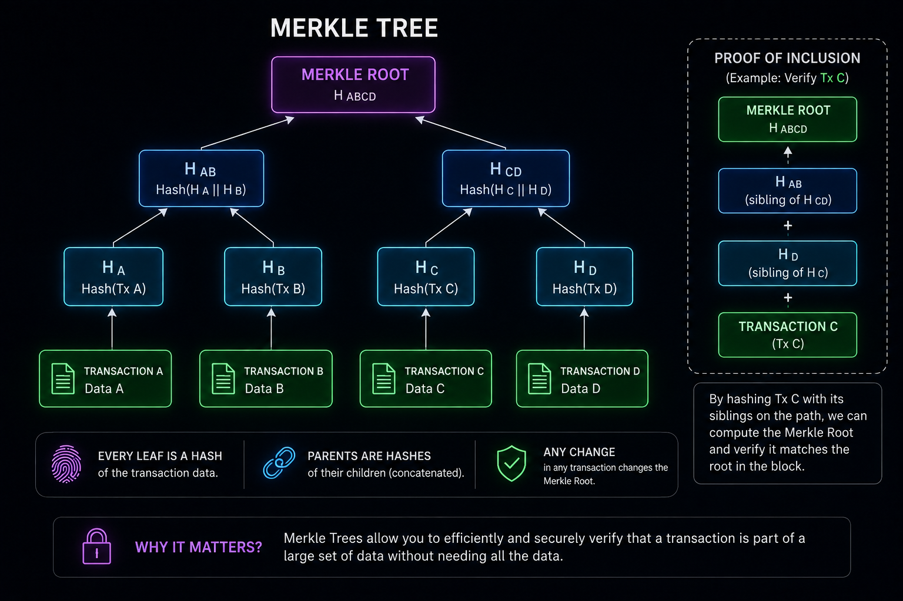

# What Is a Merkle Tree and What Is Its Role in Blockchain?

## Introduction

In a blockchain, especially in networks such as Bitcoin and Ethereum, each block can contain a large number of transactions.

This raises an important question:

> How can we prove that a particular transaction actually belongs to a block without checking every transaction individually?

This is where the **Merkle Tree** comes in.

A **Merkle Tree** is a hash-based data structure that allows a large collection of data to be represented by a single final hash called the **Merkle Root**.

This structure allows blockchain systems to:

- Represent large amounts of data compactly.
- Detect changes to even a single piece of data.
- Efficiently prove that a transaction belongs to a particular set.
- Verify data membership without requiring the entire dataset.

---

# What Is a Merkle Tree?

A **Merkle Tree** is a tree-shaped data structure that uses **Hash Functions** to connect pieces of data together.

Suppose we have four transactions:

```text
Transaction A
Transaction B
Transaction C
Transaction D
```

First, each transaction is hashed:

```text
Hash(A)
Hash(B)
Hash(C)
Hash(D)
```

These hashes are called **Leaf Nodes**.

Next, adjacent hashes are combined and hashed again:

```text
Hash(Hash(A) + Hash(B))
Hash(Hash(C) + Hash(D))
```

Finally, these two hashes are combined and hashed one more time:

```text
Hash(
    Hash(Hash(A) + Hash(B))
    +
    Hash(Hash(C) + Hash(D))
)
```

The final hash is the **Merkle Root**.

---

# Structure of a Merkle Tree

A simple Merkle Tree can be represented like this:

```text
                    Merkle Root
                         │
              ┌──────────┴──────────┐
              │                     │
            Hash AB               Hash CD
              │                     │
        ┌─────┴─────┐         ┌─────┴─────┐
        │           │         │           │
      Hash A      Hash B    Hash C      Hash D
        │           │         │           │
        A           B         C           D
```

The original data is located at the bottom of the tree.

Each piece of data is first hashed.

Then, neighboring hashes are combined and hashed again.

This process continues until only one hash remains.

That final hash is the:

**Merkle Root**

---

# Why Do We Use Hashes?

To understand Merkle Trees, we first need to understand the role of hashing.

A **Hash Function** takes an input of arbitrary size and produces an output of fixed size.

Conceptually:

```text
Transaction
     ↓
Hash Function
     ↓
Hash
```

One important property is that changing the input causes the resulting hash to change significantly.

For example:

```text
Transaction A
     ↓
Hash A
```

If even a small part of Transaction A changes:

```text
Transaction A'
     ↓
Hash A'
```

Then:

```text
Hash A ≠ Hash A'
```

This property makes hashing extremely useful for detecting data changes.

---

# What Is the Merkle Root?

The **Merkle Root** is the final hash at the top of a Merkle Tree.

It represents the entire set of data contained in the tree.

For example:

```text
Transaction A
Transaction B
Transaction C
Transaction D
```

Eventually becomes:

```text
Merkle Root
```

Instead of placing every transaction inside a block header, a system can keep a single root value that represents the entire collection.

Conceptually:

```text
Thousands of Transactions
          ↓
      Merkle Tree
          ↓
     Merkle Root
```

---

# What Happens If a Transaction Changes?

This is one of the most important properties of a Merkle Tree.

Suppose we have:

```text
A
B
C
D
```

And the tree is:

```text
             Root
              │
        ┌─────┴─────┐
       AB            CD
      /  \          /  \
     A    B        C    D
```

Now suppose Transaction C changes.

First:

```text
C → Hash C
```

becomes a different hash.

As a result:

```text
Hash C
   ↓
Hash CD
   ↓
Merkle Root
```

All hashes along the path from C to the root change.

Therefore, even a small modification to a single transaction can produce a completely different Merkle Root.

If someone modifies a transaction, the resulting Merkle Root will no longer match the original root.

---

# How Is a Merkle Tree Used in Blockchain?

Now we reach the main purpose of Merkle Trees in blockchain systems.

A blockchain may need to answer this question:

> How can we prove that a transaction belongs to a block without checking every transaction in that block?

The answer is:

**Merkle Proof**

---

# What Is a Merkle Proof?

Suppose a block contains 1,024 transactions and we want to prove that:

```text
Transaction C
```

belongs to that block.

The simplest approach would be to obtain and examine all 1,024 transactions.

But this is unnecessary.

A Merkle Tree allows us to use only the hashes needed to reconstruct the path from the target transaction to the Merkle Root.

For example:

```text
                Root
                 │
          ┌──────┴──────┐
          AB             CD
                         │
                    ┌────┴────┐
                    C         D
```

To prove that C exists, we do not need the entire tree.

We only need the information required to reconstruct its path to the root.

Conceptually:

```text
Transaction C
     +
Hash D
     ↓
Hash(CD)
     +
Hash AB
     ↓
Merkle Root
```

If the calculated root matches the Merkle Root stored or committed by the blockchain, the proof is valid.

---

# Why Is This Important?

Suppose a block contains:

```text
1,000,000 transactions
```

A naive verification method might require checking a huge amount of data.

But a Merkle Tree has a logarithmic structure.

For a balanced binary tree, the number of hashes required for a proof is roughly:

```text
log₂(N)
```

For example:

```text
N = 1,024
```

Then:

```text
log₂(1024) = 10
```

So a Merkle proof can require only about 10 sibling hashes instead of examining all 1,024 transactions.

This is one of the major advantages of Merkle Trees.

---

# Merkle Trees and Blockchain Blocks

A blockchain block can be conceptually divided into parts such as a **Header** and a **Body**.

For example:

```text
Block
│
├── Block Header
│
└── Block Body
      │
      └── Transactions
```

In blockchain systems that use a Merkle-style transaction commitment, information about the transaction set can be represented by a root hash.

Conceptually:

```text
Transactions
      ↓
Merkle Tree
      ↓
Merkle Root
      ↓
Block Header / Block Metadata
```

The block can therefore commit to a large collection of transactions using a relatively small root value.

---

# Does the Merkle Root Store All Transactions?

No.

This is a very important point.

The **Merkle Root is not the transactions themselves.**

It is not even a list of all transactions.

The Merkle Root is simply a final hash that depends on the structure and contents of the tree.

Conceptually:

```text
Transactions
      ↓
Hashing
      ↓
Merkle Tree
      ↓
Merkle Root
```

Therefore, if you only have the Merkle Root, you cannot reconstruct the original transactions from it.

This follows from the one-way nature of cryptographic hash functions.

---

# What Does a Merkle Tree Add to Blockchain?

The most important benefits can be summarized as follows.

## 1. Detecting Data Changes

If a transaction changes, its hash changes.

That change propagates upward through the tree.

Eventually:

```text
Transaction changes
        ↓
Leaf Hash changes
        ↓
Parent Hash changes
        ↓
Merkle Root changes
```

The Merkle Root therefore acts like a cryptographic commitment to the underlying data.

---

## 2. Proving Data Membership

Using a Merkle Proof, a system can prove that a specific piece of data belongs to a particular set.

Conceptually:

```text
Transaction X
      ↓
Merkle Proof
      ↓
Merkle Root
```

If the required hashes reconstruct the expected root, the membership proof is valid.

---

## 3. Reducing the Data Required for Proofs

To prove that a particular piece of data belongs to a set, we do not need the entire dataset.

Instead, we can use:

```text
Transaction
+
Required Hashes
+
Merkle Root
```

This can significantly reduce the amount of information required for verification.

---

# Merkle Trees in Bitcoin

Bitcoin uses a **Merkle Tree** to organize the transactions in a block, with the resulting Merkle Root included in the **Block Header**.

Conceptually:

```text
Transactions
      ↓
Merkle Tree
      ↓
Merkle Root
      ↓
Block Header
```

This gives the block header a compact cryptographic commitment to the block's transaction set.

Merkle proofs are also important for verifying transaction inclusion without requiring every transaction in the block.

---

# Merkle Trees in Ethereum

Ethereum is more complex.

Ethereum does not simply use one ordinary Merkle Tree for everything.

Instead, Ethereum uses more advanced structures, including the **Merkle Patricia Trie**.

This combines ideas from:

- Merkle Trees
- Patricia Tries

This becomes especially important when studying fields such as:

```text
stateRoot
transactionsRoot
receiptsRoot
```

Conceptually:

```text
Transactions
      ↓
Transactions Trie
      ↓
transactionsRoot
```

And:

```text
World State
      ↓
State Trie
      ↓
stateRoot
```

Therefore, in Ethereum, the broader concept of hash-based tree structures is used not only for transactions, but also to create cryptographic commitments to different parts of the blockchain's data and state.

---

# Merkle Tree vs. Merkle Patricia Trie

These two concepts should not be treated as the same thing.

## Merkle Tree

A Merkle Tree is a hash-based tree structure used to summarize a collection of data into a root hash.

```text
Data
 ↓
Hash
 ↓
Tree
 ↓
Root
```

## Merkle Patricia Trie

A **Merkle Patricia Trie** is a more advanced structure that combines properties of:

```text
Merkle Tree
+
Patricia Trie
```

It is especially important in Ethereum for storing and proving key-value data.

Conceptually:

```text
Merkle Tree
      │
      └── Fundamental concept
             ↓
Merkle Patricia Trie
      │
      └── More advanced structure
             ↓
          Ethereum
```

---

# Why Does Blockchain Need Merkle Trees?

A blockchain is a distributed system.

Thousands or even millions of computers may need to verify the integrity and state of blockchain data.

If every verification required transferring and checking the entire dataset, the system would become inefficient.

Merkle Trees allow a large dataset to be represented by a small root hash:

```text
Millions of Data
       ↓
   Hash Tree
       ↓
   One Root Hash
```

When necessary, a proof can then provide only the information required to verify a particular piece of data.

---

# A Simple Example

Suppose a block contains four transactions:

```text
A
B
C
D
```

First:

```text
HA = Hash(A)
HB = Hash(B)
HC = Hash(C)
HD = Hash(D)
```

Then:

```text
HAB = Hash(HA + HB)

HCD = Hash(HC + HD)
```

Finally:

```text
Root = Hash(HAB + HCD)
```

The complete structure is:

```text
                    Root
                      │
              ┌───────┴───────┐
              │               │
             HAB             HCD
            /   \           /   \
          HA     HB       HC     HD
          │      │        │      │
          A      B        C      D
```

Now suppose B changes:

```text
B
↓
HB changes
↓
HAB changes
↓
Root changes
```

Therefore, a modification to a single transaction affects the final root.

---

# Summary

A **Merkle Tree** is a hash-based data structure that allows a large collection of data to be summarized by a single **Root Hash**.

In blockchain systems, it is important because it can:

1. **Represent a large dataset using a single root hash.**
2. **Make changes to the underlying data detectable.**
3. **Prove that a transaction or piece of data belongs to a set without checking the entire set.**
4. **Reduce the amount of data required for certain proofs.**
5. **Provide cryptographic commitments that are useful in distributed and trust-minimized systems.**

The most important chain to remember is:

```text
Data
  ↓
Hash
  ↓
Merkle Tree
  ↓
Merkle Root
  ↓
Cryptographic Commitment to the Data
```

And in blockchain:

```text
Transactions / State
        ↓
   Hash-based Tree
        ↓
      Root Hash
        ↓
 Blockchain Data / State Commitment
```

Merkle Trees are therefore one of the fundamental ideas behind **efficient data verification and cryptographic commitments in blockchain systems**.

To fully understand their role in Ethereum, the next step is to study the **Merkle Patricia Trie**, followed by concepts such as **State Root, Transactions Root, and Receipts Root**.
