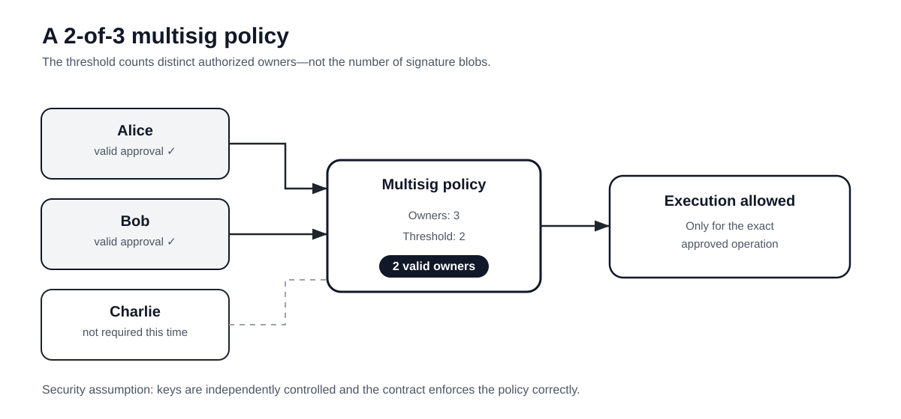
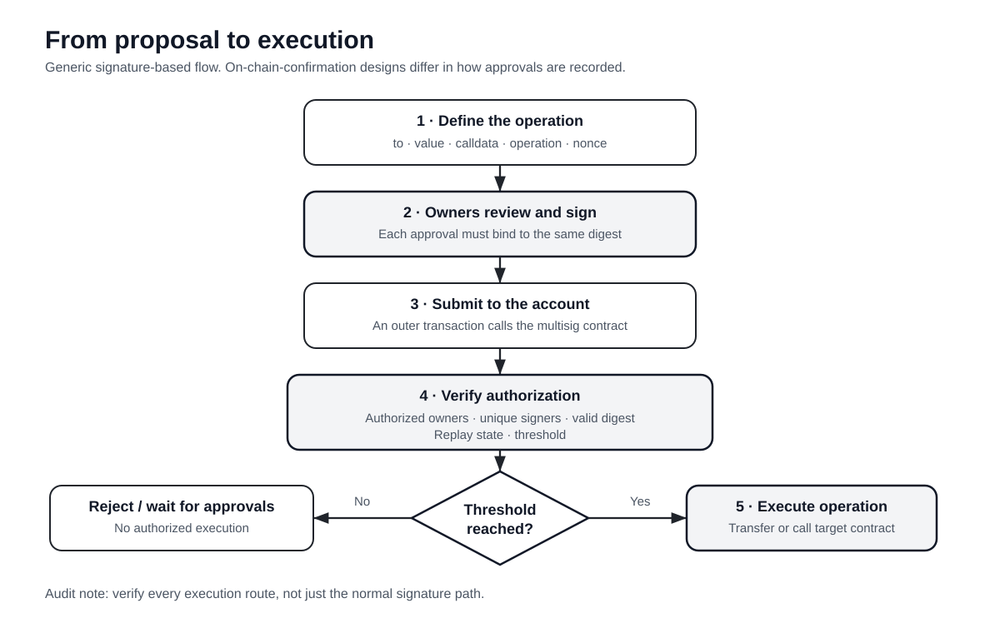
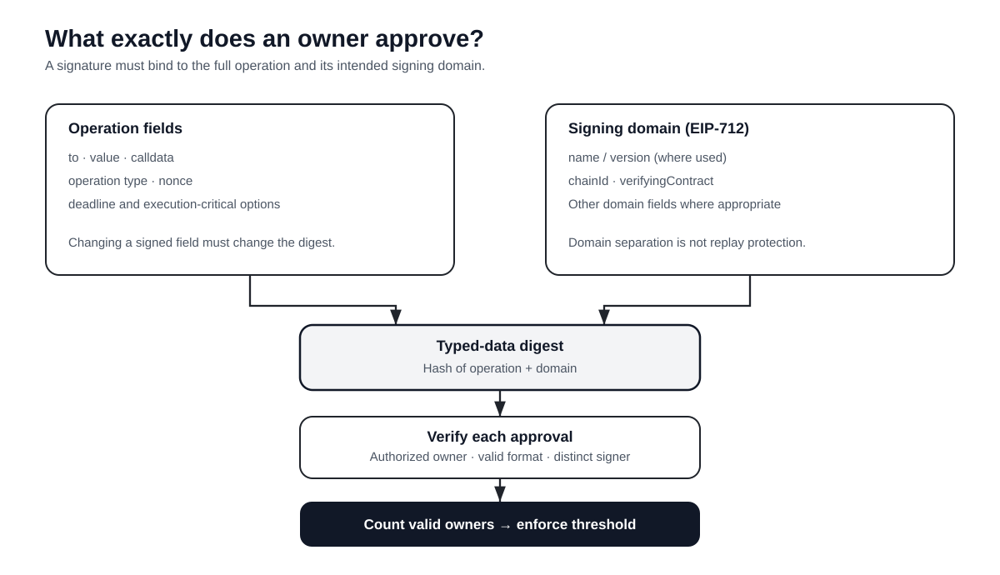

# Multisig Contracts: Owners, Thresholds, Signatures, and Security

> **Audience:** Smart contract developers who want to understand smart accounts and reason about their security.
>
> **Scope:** This is an educational architecture guide, not production wallet code. A real multisig controls valuable assets; use a well-reviewed implementation rather than copying a tutorial wallet into production.

A multisignature contract (usually called a **multisig**) is a smart-contract account that requires a policy-defined set of approvals before it executes a sensitive action. The most familiar policy is **M-of-N**: at least **M distinct authorized owners out of N total owners** must approve the same operation.

Multisig is best understood as an **authorization mechanism**, not simply as “a wallet with several keys.” The contract must define exactly what is being approved, whose approvals count, when an approval becomes invalid, and which execution paths are allowed.

## What you will learn

- How an M-of-N threshold works and what it does—and does not—protect against.
- How a proposal moves from signing to verification and execution.
- The difference between on-chain confirmations and off-chain signatures.
- Why transaction hashing, domain separation, nonces, and signer uniqueness matter.
- Which invariants and attack surfaces a Smart Contract Auditor should inspect.

## 1. The M-of-N model

Consider a treasury controlled by three owners: Alice, Bob, and Charlie. The policy is **2-of-3**.

Two valid approvals are sufficient; one is not. The third owner does not have to approve every action.

- **N — owners:** the total set of authorized signers.
- **M — threshold:** the minimum number of distinct valid owners required.
- **Policy:** the rules for changing owners, changing the threshold, signing, and executing operations.

A sensible basic configuration requires `1 ≤ M ≤ N`. A threshold of zero may eliminate the intended approval barrier; a threshold greater than N can make execution impossible.

### What security property does it provide?

A 2-of-3 policy can prevent **one compromised key from acting alone**, assuming the implementation is correct and the keys are independently controlled. It does not protect against two compromised owners, two colluding owners, a malicious upgrade path, or a separate privileged module that bypasses normal signature verification.

Multisig reduces reliance on a single key; it does not remove the need to trust the code and the operational setup.

## 2. The account model: EOA versus smart-contract account

An Externally Owned Account (EOA) uses a private key to sign an Ethereum transaction. A multisig smart account instead implements authorization rules in contract code.

A contract account does not independently originate an Ethereum transaction in the same way an EOA does. A common flow is:

1. Owners approve a specific operation.
2. A submitter (which may be one of the owners or a relayer) sends an ordinary Ethereum transaction to the multisig contract.
3. The multisig validates the approvals.
4. If the policy is satisfied, the contract calls the target contract or transfers ETH.

The outer transaction pays gas and is submitted by an EOA or another supported transaction mechanism. The **inner call** executes from the multisig account's address, so the target contract sees the multisig as `msg.sender` when the multisig uses `CALL`.

This distinction matters in access-control design: a DeFi protocol can grant an administrative role to the multisig address, rather than to each owner separately.

## 3. A transaction's lifecycle

The diagram shows a generic signature-based flow. Implementations differ: some store each confirmation on-chain; others gather signatures off-chain and verify them together when a transaction is submitted.

At a high level:

1. **Propose:** define the exact operation, including target, value, calldata, operation type, and replay-protection data.
2. **Review:** each signer independently checks the human-readable details and consequences.
3. **Sign or confirm:** owners approve the same operation using the implementation's supported confirmation mechanism.
4. **Verify:** the contract checks the transaction digest and proves that enough distinct authorized owners approved it.
5. **Execute:** only after authorization succeeds may the account transfer ETH or invoke a target.
6. **Record:** events and state changes make the lifecycle auditable, subject to what the implementation emits and stores.

A crucial point: **the threshold must apply to the same transaction**, not merely to a pool of signatures that happen to be valid for unrelated messages.

## 4. Two common implementation patterns

### Pattern A — On-chain confirmations

A typical teaching implementation has methods resembling `submitTransaction`, `confirmTransaction`, and `executeTransaction`. The contract stores proposals and the owners' confirmations in state.

**Advantages**
- Confirmation state and transaction status can be inspected on-chain.
- The lifecycle is relatively straightforward to follow.
- The contract can enforce one confirmation per owner per proposal using explicit state.

**Trade-offs**
- Each confirmation may require a separate transaction and gas.
- State grows as proposals and confirmation records accumulate.
- The precise execution and cancellation rules still need careful design.

### Pattern B — Off-chain signatures, on-chain verification

Owners sign a structured transaction off-chain. A submitter collects the signatures and sends them to the contract, which validates them as part of execution. This avoids requiring every owner to submit a separate confirmation transaction.

Safe Smart Accounts use this general signature-threshold model. Their actual signature formats and execution logic are richer than a minimal tutorial design, so study the implementation and its documentation rather than assuming every multisig works identically.

**Advantages**
- Owners can sign without each sending a separate on-chain confirmation transaction.
- Collection and coordination can happen through an off-chain service.
- One submitter can present the collected approvals for execution.

**Trade-offs**
- The signature-verification code becomes security-critical.
- The signed digest must bind all fields that affect execution.
- Signature ordering, duplicates, contract signers, replay prevention, and failure handling need explicit treatment.

Neither pattern is automatically more secure. The important question is whether the chosen implementation enforces its stated authorization policy across every execution path.

## 5. What exactly should owners sign?

A signature is meaningful only if it unambiguously commits to the operation the signer reviewed. A transaction structure might conceptually contain:

- `to`: the destination address.
- `value`: ETH to transfer.
- `data`: the exact calldata sent to the destination.
- `operation`: the execution mode, where supported.
- `nonce`: a unique sequence value or transaction identifier.
- `deadline`: an optional expiry, if the design uses one.
- Any gas, refund, or other fields that materially affect execution.

The **digest** must bind every field that can change what the account does. Omitting an execution-critical field can let a signature be reused with altered behavior.

### EIP-712: structured signing and domain separation

[EIP-712](https://eips.ethereum.org/EIPS/eip-712) standardizes hashing and signing of typed structured data. Its domain can include values such as a name, version, chain ID, and verifying-contract address. This helps make a signature's intended context explicit.

But **EIP-712 does not itself provide replay protection**. A design still needs appropriate replay controls, commonly a nonce or unique transaction identifier, and may also use an expiry. Auditors should verify that those controls are actually checked and updated correctly.

When reviewing a signature scheme, ask:

- Does the digest include the target, value, calldata, operation type, nonce, and every other execution-relevant field?
- Is the domain bound to the intended chain and verifying account?
- Can the same signature be accepted twice?
- Can it be replayed on another account or chain under the supported threat model?
- Is the exact same digest verified for every counted signature?
- Can a transaction be changed after owners have signed it?

Do not hand-roll cryptographic encoding without a compelling reason. Prefer well-reviewed libraries and the signing format expected by the target implementation.

## 6. Signature verification: what must be true?

A valid threshold is more than a count of byte strings. The contract must establish that each counted approval represents a distinct eligible owner approving the correct digest.

A verifier may need to handle EOA signatures and, if supported, contract-based signers. [ERC-1271](https://eips.ethereum.org/EIPS/eip-1271) defines a standard interface through which a contract can report whether a signature is valid for a given hash. ERC-1271 is a signature-validation interface; it is not a complete multisig execution design.

For ECDSA-based signatures, implementation details such as accepted signature encodings, signer recovery, and canonical values matter. For contract signatures, validation may involve an external call and can have different gas and failure behavior. Support only the signature types that the implementation intends to support, and test each path.

### A minimal mental model

The following is **pseudocode, not deployable Solidity**:

~~~text
execute(operation, signatures):
    digest = hash_exact_operation_and_domain(operation)

    require(operation.nonce == expected_nonce)
    require(signatures_are_valid_for_digest(signatures))
    require(count_distinct_authorized_signers(signatures) >= threshold)

    consume_replay_protection_state(operation)
    execute_the_authorized_operation(operation)
~~~

Real implementations must define what happens if execution fails, how nonces and state behave on reverts, how callbacks are handled, and whether any alternate execution path exists. Those details cannot safely be filled in with a generic snippet.

## 7. Security properties and audit checklist

A developer should treat the following as explicit properties to design and test—not just as a checklist to skim at the end.

### Owner and threshold invariants

- Every owner is valid under the design; zero addresses and duplicate owners are rejected where inappropriate.
- The threshold is always within the permitted range.
- A signer is counted at most once for a given operation.
- Adding, replacing, or removing owners—and changing the threshold—requires the intended authorization.
- Initialization cannot be repeated or captured by an unauthorized party, especially when proxies or factories are involved.

### Signature and replay invariants

- Every signature refers to the same complete digest.
- Altering any execution-critical field invalidates the prior signatures.
- Expired operations are rejected if deadlines are part of the design.
- A completed operation cannot be executed again unless the protocol deliberately supports that behavior.
- Nonce progression and failure semantics are consistent and tested.
- Supported signature types cannot bypass owner or threshold validation.

### Execution invariants

- No transfer or target call occurs until authorization passes.
- External calls cannot re-enter a partially updated state and violate the authorization policy.
- A failed target call has clearly defined effects on the nonce, status, and retry behavior.
- Any `DELEGATECALL` path is deliberately restricted and understood. `DELEGATECALL` runs target code in the caller's storage context and can therefore be extremely powerful.
- Every privileged route—including modules, fallback handlers, guards, recovery logic, or upgrade hooks where present—has been included in the threat model.

### Operational and availability risks

A multisig can be secure against unauthorized execution and still become unusable. Lost keys, unavailable signers, broken recovery processes, or a threshold that is too demanding can prevent legitimate operations. Conversely, a low threshold or poorly separated signing devices can make collusion or compromise much easier.

Review the key-management process as well as the code: are keys independently controlled, is there a safe recovery procedure, and can the system keep operating when a signer is unavailable?

## 8. Testing strategy for a Solidity developer

Use a local test environment such as Foundry to test both expected behavior and adversarial cases.

**Positive tests**
- Exactly M distinct valid owners can authorize an operation.
- Any permitted set of M owners works, regardless of which owners they are.
- The operation executes with the expected target, value, and calldata.
- Owner and threshold changes work only through the authorized path.

**Negative tests**
- M−1 valid signatures are insufficient.
- A non-owner signature is rejected.
- A duplicate signer cannot satisfy the threshold.
- A signature for a different digest cannot be substituted.
- Wrong nonce, expired deadline, malformed signature, and unauthorized owner changes are rejected.
- Replaying an already-consumed operation fails.
- A malicious target or callback cannot bypass authorization or corrupt state.

**Invariant and fuzz tests**
- The number of counted signers never exceeds the number of distinct authorized owners.
- No operation executes unless the authorization condition holds.
- No operation is executed twice under the same one-time transaction identifier.
- Owner and threshold state always remains within its declared constraints.

Tests need to assert the security property, not merely that a function reverts. For example, after an unauthorized attempt, verify that no asset moved and no sensitive state changed.

## 9. Implementation-specific features: Safe modules and guards

Real smart accounts can add capabilities beyond a core threshold policy. In Safe, **modules** can provide additional execution routes, while **guards** can inspect or restrict transactions. These features are not universal properties of all multisigs; they are implementation-specific parts of the trust model.

For an audit, do not stop after verifying the default signature path. Identify every component able to trigger execution, alter authorization, or change the account's behavior. A correct threshold check is not sufficient if another privileged route can bypass it.

Start with the official resources:
- [Safe Smart Account Overview](https://docs.safe.global/advanced/smart-account-overview)
- [Safe Smart Account Concepts](https://docs.safe.global/advanced/smart-account-concepts)
- [Safe contract repository](https://github.com/safe-fndn/safe-smart-account)

## 10. Multisig is not the same as threshold cryptography

In a contract-based multisig, the contract commonly verifies approvals from several owners under an explicit policy. In a threshold-signature scheme, multiple participants cooperate cryptographically to produce a signature that can resemble a single signer's signature at the verification layer.

The user experience can look similar, but the cryptographic design, on-chain verification, key-management assumptions, and audit surface differ. Do not assume that every threshold-signature wallet uses an on-chain M-of-N contract.

## 11. A practical learning exercise

Build a **disposable educational 2-of-3 wallet on a local chain only**. Do not use it to hold real funds.

1. Store three authorized owners and a threshold.
2. Define a proposal with a destination, value, calldata, and unique nonce.
3. Implement one explicit approval model: on-chain confirmations or typed off-chain signatures.
4. Write Foundry tests for the positive and negative cases above.
5. Add a malicious target that attempts a callback and test that authorization remains intact.
6. Write a short audit report: threat model, invariants, test evidence, and the limitations of your implementation.

Then compare your design with Safe's code. Note which security features your educational wallet lacks, and why those omissions matter. The goal is to understand the architecture, not to create a production competitor to a battle-tested account.

## Key takeaways

- Multisig is a policy for authorizing operations, usually expressed as M-of-N.
- Signatures must bind to one exact operation and be counted only once per authorized signer.
- Domain separation and replay protection are related but distinct; EIP-712 does not replace nonces.
- Execution, external calls, owner changes, initialization, modules, and recovery are all part of the security boundary.
- The best audit combines code review, explicit invariants, adversarial tests, and an understanding of operational key management.

**Developer's rule of thumb:** Do not ask only “Are there enough signatures?” Ask “Enough signatures from whom, for exactly what operation, under which domain, with what replay guarantees, and through which execution paths?”
