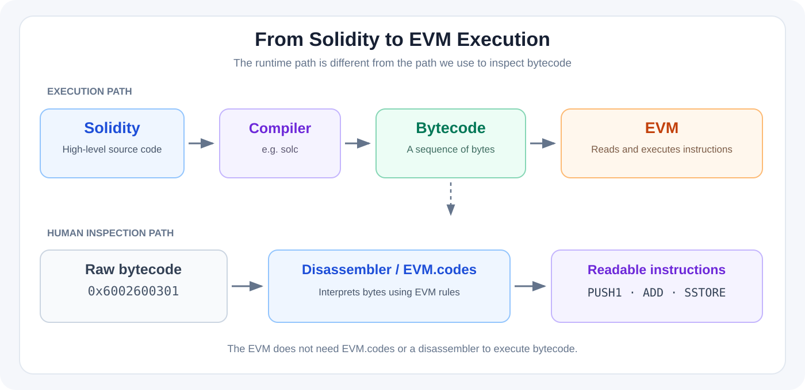
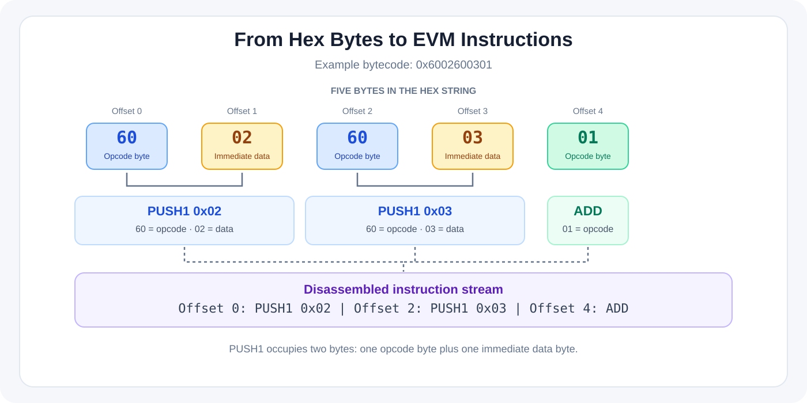
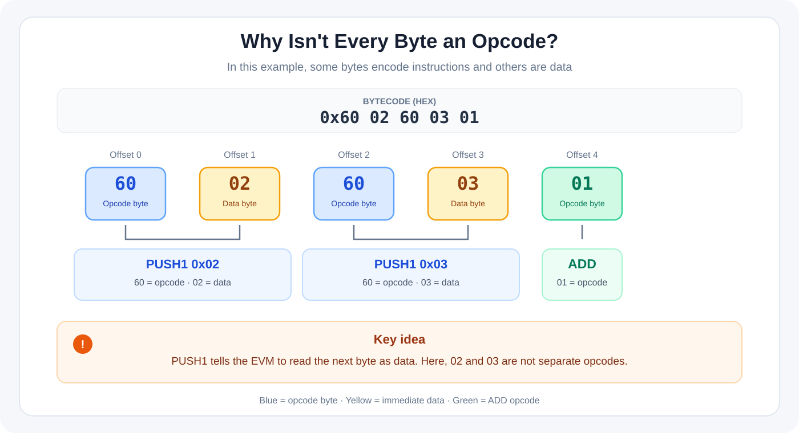
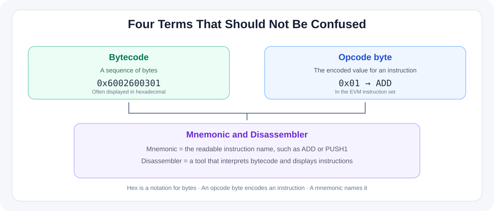

# Bytecode and Opcodes: Reading the EVM's Instructions

This guide explains how Solidity becomes EVM bytecode, what hexadecimal notation means, and how tools make low-level instructions readable. The goal is to understand the relationship between these layers—not to memorize every opcode.

## Overview



**Two paths are shown above.** During execution, the EVM reads bytecode and executes its instructions. For human inspection, tools such as EVM.codes disassemble the bytecode and display the instructions in a readable form. The EVM does not need a disassembler or EVM.codes to execute a contract.

## 1. Four terms to understand

### Solidity

Solidity is a high-level language developers use to write smart contracts. For example:

```solidity
function add(uint256 a, uint256 b) external pure returns (uint256) {
    return a + b;
}
```

This code expresses the intent to add two values and return the result.

### Bytecode

The compiler translates Solidity into code that the Ethereum Virtual Machine (EVM) can execute. This output is called **bytecode**: a sequence of bytes. It is commonly displayed in hexadecimal, for example:

```text
0x6002600301
```

This short sequence is a teaching example; it is not presented as the exact compiler output for the Solidity function above.

### Opcode and mnemonic

An **opcode** is an operation defined by the EVM instruction set, such as `ADD`, `SLOAD`, or `CALL`. Each EVM instruction has a one-byte opcode value. The opcode byte `0x01`, for example, identifies `ADD`.

The readable name—`ADD`, `PUSH1`, `SSTORE`—is called the instruction's **mnemonic**. Keep these ideas distinct:

- **Opcode byte:** the encoded byte value, such as `0x01`.
- **Mnemonic:** the human-readable name, such as `ADD`.
- **Bytecode:** the full sequence of bytes, which can contain opcode bytes and data bytes.

### Disassembler

A **disassembler** interprets bytecode according to the target machine's instruction set and displays instructions in a human-readable form. EVM.codes provides an interactive opcode reference and playground for exploring EVM instructions and their effects.

## 2. What is hexadecimal?

**Hexadecimal (hex)** is a base-16 number system. It uses the digits `0–9` and the letters `A–F`. Computers process data as bits; hexadecimal is a compact, human-friendly way to write groups of bits.

- One hexadecimal digit represents four bits.
- One byte contains eight bits, so two hexadecimal digits normally represent one byte.
- The prefix `0x` signals that the following value is written in hexadecimal. The prefix itself is not part of the byte sequence.

For example:

```text
Hex:    0x60
Binary: 01100000
```

The bytecode `0x6002600301` can be spaced out for readability:

```text
60  02  60  03  01
```

That is five bytes, represented by ten hexadecimal digits after `0x`.

**Hexadecimal is a notation, not an opcode or a separate programming language.** To determine which bytes represent instructions and which represent instruction data, we need to apply the EVM instruction rules.

## 3. A worked example: disassembling bytecode

Consider this bytecode:

```text
0x6002600301
```

Following the EVM instruction rules, it disassembles to:



The sequence represents three instructions:

1. **`PUSH1 0x02`** — `0x60` is the opcode byte for `PUSH1`; the following byte `0x02` is the one-byte value pushed onto the stack.
2. **`PUSH1 0x03`** — the next `0x60` begins another `PUSH1`; `0x03` is its data byte.
3. **`ADD`** — `0x01` is the opcode byte for `ADD`. It adds the top two stack values and pushes the result, which is 5.

### Why isn't every byte an opcode?



The key detail is that `PUSH1` tells the EVM to read the next **one byte as data**. In this example, `0x02` and `0x03` are not separate instructions. They are immediate data consumed by the preceding `PUSH1` instructions.

### What do offsets `00`, `02`, and `04` mean?

Offsets are byte positions in the bytecode, not opcode values and not Solidity source-line numbers. The first `PUSH1` starts at offset 0 and occupies two bytes: one opcode byte and one data byte. The next instruction therefore starts at offset 2. The second `PUSH1` also occupies two bytes, so `ADD` starts at offset 4.

### Keep these concepts separate



## 4. A short history of opcodes and bytecode

### Before blockchain: machine code and assembly

Opcodes did not originate with Ethereum. Computers have long executed machine instructions encoded as binary values. Because raw binary and numeric instruction codes are difficult for people to read, assembly languages use short mnemonics such as `ADD` or `MOV`.

The broad idea is similar across computing systems, but each architecture defines its own instruction set. EVM opcodes are **not** the same as CPU opcodes for architectures such as x86; the encoding and execution rules differ.

Hexadecimal notation is likewise older than blockchain. It is a convenient way to display bytes without writing every bit individually.

### Ethereum and the EVM

- **2013:** Vitalik Buterin proposed the Ethereum idea and shared the initial whitepaper.
- **2014:** The Ethereum whitepaper described a platform for smart contracts and a virtual machine that executes contract code.
- **July 30, 2015:** Ethereum's main network launched with the Frontier release and its genesis block.
- **Today:** Solidity compilers produce EVM bytecode, which Ethereum clients execute according to the EVM specification. The instruction set has evolved through protocol upgrades, so use a current reference when analyzing real contracts.

**Historical takeaway:** Machine code, opcodes, and hexadecimal notation predate blockchains. Ethereum applies these ideas through a virtual machine with shared execution rules for smart contracts.

## 5. Exploring EVM.codes

### Opcode reference table

- **Name** shows the readable instruction mnemonic, such as `ADD`.
- **Opcode** shows the hexadecimal opcode value, such as `01` for `ADD`.
- Instruction descriptions, stack inputs and outputs, memory/storage effects, and gas information help explain what each operation does.

### Playground

The instruction listing is a readable disassembly of the bytecode, not the raw bytecode itself. An entry such as `PUSH1 80` shows an instruction and its associated data. Offsets indicate where instructions begin in the byte sequence.

### Step-by-step execution

The Playground can help you observe execution state such as the stack, memory, storage, and return value. Step through a short example and check what changes after each instruction.

## 6. Why opcodes matter to smart-contract developers

### Understanding execution

Opcodes make the EVM's low-level behavior concrete: you can see how instructions use the stack, memory, storage, and control flow. This complements—rather than replaces—understanding Solidity.

### Reasoning about gas

Operations such as `SLOAD`, `SSTORE`, and memory access help explain execution costs. Gas cannot always be inferred from an opcode name alone: storage state, memory expansion, input sizes, and the active protocol rules can matter too.

### Debugging failed transactions

Debuggers and execution traces can show which instruction was executing when a failure occurred and what happened just before it. Seeing `REVERT` alone does not explain the root cause; inspect the call path, inputs, and execution state as well.

### Analyzing deployed contracts without verified source

Bytecode and disassembly can provide clues about a deployed contract's behavior when verified source code is unavailable. This is harder than source-level analysis, and a disassembler cannot always reconstruct the original Solidity structure exactly.

Opcodes are one tool in a wider workflow; they do not replace tests, source review, traces, or a complete security analysis.

## 7. Do you need to memorize every opcode?

**No.** Start by understanding the role of common instruction groups and keep a reference nearby.

- **Stack and values:** `PUSH`, `POP`, `DUP`, `SWAP`
- **Memory and call data:** `MLOAD`, `MSTORE`, `CALLDATALOAD`
- **Persistent storage:** `SLOAD`, `SSTORE`
- **Control flow and errors:** `JUMP`, `JUMPI`, `REVERT`, `RETURN`
- **Contract calls:** `CALL`, `STATICCALL`, `DELEGATECALL`

You do not need to learn them all at once. The useful skill is being able to explain what an instruction reads, what it changes, and how it affects execution in a specific example.

## 8. Suggested practice path

1. Open `0x6002600301` in the [EVM.codes Playground](https://www.evm.codes/playground) and identify the three instructions.
2. Step through execution and watch how the stack changes.
3. Compile a small Solidity contract, then compare its bytecode with the disassembled instructions. Compiler settings and optimization can change the output.
4. For real Solidity bugs, use a debugger such as [Remix](https://remix.ethereum.org/) or execution traces in [Foundry](https://book.getfoundry.sh/forge/traces). EVM.codes is excellent for learning the instruction set, but it does not always identify the exact source line responsible for a bug.

## Final summary

- **Solidity** is the high-level code developers write.
- **Bytecode** is the sequence of bytes produced by compilation; it is often displayed in hexadecimal.
- **Opcode byte** is the encoded value identifying an EVM instruction.
- **Mnemonic** is the readable instruction name, such as `ADD`.
- **Disassembler** is a tool that interprets bytecode and displays the instructions in readable form.

The practical flow is:

```text
Solidity → Compiler → Bytecode → EVM executes instructions

For human inspection:
Bytecode → Disassembler / EVM.codes → Readable instructions
```

For a smart-contract and DeFi development path, you do not need to become a bytecode-analysis expert before building contracts. Keep learning programming, write and test contracts, and return to opcode-level analysis when it helps you understand execution more deeply.

## References

- [EVM.codes — interactive EVM opcode reference and playground](https://www.evm.codes/)
- [Ethereum.org — The Ethereum Virtual Machine](https://ethereum.org/developers/docs/evm/)
- [Ethereum.org — Opcodes for the EVM](https://ethereum.org/developers/docs/evm/opcodes/)
- [Ethereum Whitepaper](https://ethereum.org/whitepaper/)
- [Ethereum.org — History of Ethereum](https://ethereum.org/ethereum-history-founder-and-ownership/)
- [Ethereum Foundation — Ethereum launches, July 30, 2015](https://blog.ethereum.org/2015/07/30/ethereum-launches)
- [North Carolina State University — Binary and hexadecimal](https://e115.engr.ncsu.edu/hardware/binary/)
- [Remix IDE](https://remix.ethereum.org/)
- [Foundry — Traces](https://book.getfoundry.sh/forge/traces)
