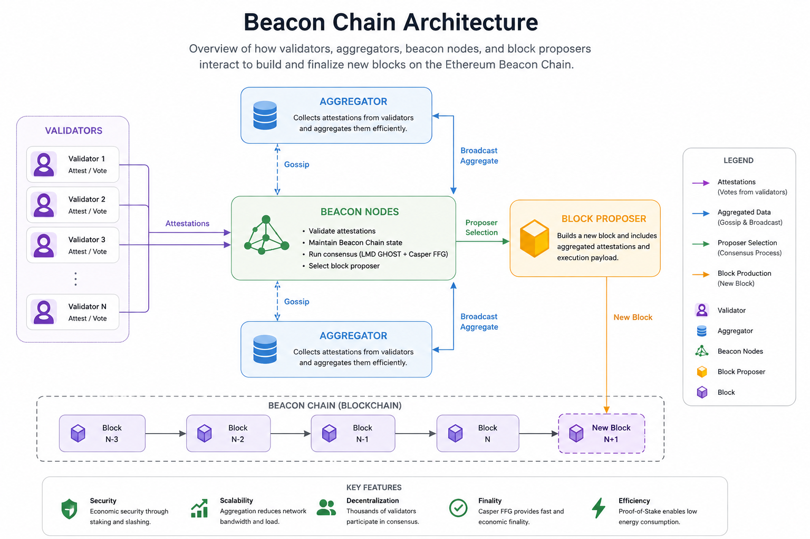

# Beacon Chain: The Foundation of Ethereum's Proof-of-Stake Consensus

## 1. Introduction

Ethereum is one of the most important blockchain platforms in the world. It was created to support not only digital currency transactions but also smart contracts, decentralized applications, and many other blockchain-based technologies. As the Ethereum network grew, its developers faced several challenges related to energy consumption, security, and scalability.

For many years, Ethereum used a consensus mechanism called Proof of Work (PoW). In this system, miners used computational power to validate transactions and secure the network. Although Proof of Work provided a high level of security, it required significant amounts of electricity and specialized hardware.

To address some of these limitations, Ethereum introduced a new Proof-of-Stake (PoS) consensus system. The foundation of this new system was the Beacon Chain. Launched in December 2020, the Beacon Chain introduced validators, staking, and a new way of reaching consensus on the Ethereum network.

The Beacon Chain later became a fundamental part of Ethereum when the network completed The Merge in September 2022. This event changed Ethereum from a Proof-of-Work blockchain into a Proof-of-Stake blockchain.

## 2. What Is the Ethereum Beacon Chain?

The Beacon Chain was the original Proof-of-Stake blockchain created for Ethereum. Its main purpose was to coordinate validators and manage the consensus process required to keep the network secure and synchronized.

When the Beacon Chain was launched in 2020, it operated separately from the Ethereum Mainnet. At that time, Ethereum still used Proof of Work for processing transactions and maintaining the existing blockchain. The Beacon Chain, meanwhile, was used to develop and test the new Proof-of-Stake system.

The Beacon Chain introduced several important concepts to Ethereum, including validators, staking, attestations, epochs, and slots. These concepts became essential parts of Ethereum's new consensus architecture.

It is important to understand that the Beacon Chain was not originally responsible for executing normal Ethereum transactions or smart contracts. Instead, it focused on consensus and validator coordination. This separation allowed developers to build and test the Proof-of-Stake system before connecting it to the existing Ethereum network.

## 3. How Does the Beacon Chain Work?

The Beacon Chain uses Proof of Stake instead of mining to secure the Ethereum network. In Proof of Stake, participants called validators deposit ETH as a form of economic commitment to the network.

Validators are responsible for participating in the consensus process. They can propose blocks, check blocks proposed by other validators, and submit attestations that represent their view of the correct state of the blockchain.

Time on the Beacon Chain is organized into slots and epochs. A slot is a short period of time during which a block may be proposed. A group of slots forms an epoch. These structures help Ethereum organize validator activities and coordinate the consensus process.

During each slot, a validator is selected to act as the block proposer. Other validators participate by reviewing the proposed block and providing attestations. These attestations help the network determine whether the block is valid and should become part of the canonical blockchain.

Through this process, thousands of validators can participate in maintaining a common view of the Ethereum blockchain without relying on traditional mining.

## 4. Validators and Staking

Validators are one of the most important components of Ethereum's Proof-of-Stake system. A validator is a participant that helps secure the network by taking part in the consensus process.

Originally, becoming a full Ethereum validator required depositing 32 ETH into the staking deposit contract. After becoming a validator, the participant is expected to remain online and correctly perform its assigned duties.

One of these duties is proposing blocks when selected. Another important duty is creating attestations. Validators also participate in the mechanisms that help Ethereum determine the correct chain and reach finality.

Validators can receive rewards for performing their responsibilities correctly. However, they can also face penalties if they fail to perform their duties or behave incorrectly. In serious cases of dishonest behavior, a validator can be slashed, meaning that a portion of its staked ETH can be taken away.

This economic system is an important part of Ethereum's security model. Validators have a financial incentive to behave honestly because protecting the network can generate rewards, while certain harmful actions can result in financial losses.

## 5. Attestations and Block Proposals

Attestations are an essential part of the Beacon Chain's consensus process. An attestation is essentially a validator's vote about the state of the blockchain.

When a block is proposed, other validators examine it and submit attestations. These attestations indicate that validators consider the block and its position in the chain to be correct according to the consensus rules.

Because Ethereum has a large number of validators, sending every individual vote separately could create unnecessary network overhead. This is where aggregation becomes important.

Validators' attestations can be collected and aggregated before being distributed more widely across the network. This allows Ethereum to handle a large number of validator votes more efficiently.

The block proposer can then include relevant aggregated attestations in a new block. In this way, validator participation becomes part of the information used to maintain consensus and move the blockchain forward.

## 6. The Role of Aggregators

Aggregators help make the attestation process more efficient. Instead of requiring the network to handle every validator signature individually at every stage, an aggregator can collect multiple attestations and combine them into an aggregated attestation.

Aggregators are selected from the validator set for specific duties. They collect attestations from other validators and broadcast aggregated information to the network.

This process is important because Ethereum is designed to support a very large number of validators. Without efficient aggregation, the amount of data and network communication required for consensus could become significantly larger.

The diagram below illustrates this process. Validators send their attestations toward Beacon nodes, aggregators collect and aggregate the attestations, and the aggregated information can then be broadcast and included by a block proposer.

*Figure 1. Simplified architecture of the Ethereum Beacon Chain, showing the interaction between validators, aggregators, Beacon nodes, and block proposers.*

## 7. The Beacon Chain and The Merge

One of the most important events in Ethereum's history was The Merge.

Before The Merge, Ethereum had two major components operating alongside each other. The original Ethereum Mainnet used Proof of Work for consensus, while the Beacon Chain operated using Proof of Stake.

On September 15, 2022, Ethereum completed The Merge. The existing Ethereum execution layer was connected to the Beacon Chain's Proof-of-Stake consensus layer.

After The Merge, Ethereum no longer depended on Proof-of-Work mining for consensus. Instead, validators became responsible for securing the network through Proof of Stake.

The Merge was a major technological achievement because it changed the consensus mechanism of an already large and active blockchain without replacing the entire Ethereum network.

The Beacon Chain therefore played a central role in Ethereum's transition to Proof of Stake. It provided the consensus infrastructure that Ethereum needed before and after The Merge.

## 8. Why Was the Beacon Chain Important?

The Beacon Chain was important for several reasons.

First, it introduced Proof of Stake to Ethereum. This allowed the network to move away from the energy-intensive mining process used by Proof of Work.

Second, the Beacon Chain created a structured system for managing validators. Ethereum can coordinate a very large validator set and use their participation to reach consensus about the state of the blockchain.

Third, the Beacon Chain introduced an economic security model based on staking. Validators have ETH at risk, which creates an incentive to follow the rules and behave honestly.

Another important advantage is that Proof of Stake provides a foundation for Ethereum's long-term development. Once the consensus system was established, developers could focus on additional improvements related to scalability, efficiency, and network capacity.

## 9. Beacon Chain After The Merge

The Beacon Chain did not disappear after The Merge. Instead, its Proof-of-Stake consensus functionality became an essential part of Ethereum's current architecture.

Ethereum can be understood as having different layers with different responsibilities. The execution layer is responsible for processing transactions and smart contracts, while the consensus layer manages Proof-of-Stake consensus, validator activities, and chain finality.

The Beacon Chain is closely associated with this consensus layer.

This means that users do not normally interact with the Beacon Chain directly when they send ETH or use a decentralized application. However, the consensus mechanisms introduced through the Beacon Chain operate in the background and help maintain the security and consistency of the Ethereum network.

## 10. The Importance of the Beacon Chain for Ethereum's Future

The introduction of the Beacon Chain created a foundation for the future development of Ethereum.

Proof of Stake makes it possible to secure the network without requiring large-scale mining operations. It also provides a flexible foundation for Ethereum's ongoing upgrades.

The Beacon Chain's architecture is particularly important for Ethereum's efforts to improve scalability. Many of Ethereum's long-term improvements depend on having an efficient consensus system capable of coordinating a large validator set.

In addition, staking has become an important part of the Ethereum ecosystem. Users can participate in network security directly as validators or indirectly through various staking solutions.

As Ethereum continues to evolve, the consensus mechanisms introduced by the Beacon Chain remain an important part of the network's overall design.

## 11. Conclusion

The Beacon Chain represents one of the most important stages in the development of Ethereum. It introduced the Proof-of-Stake consensus system, established the validator framework, and created the foundation for Ethereum's transition away from Proof of Work.

Its launch in December 2020 was the beginning of a major transformation. Almost two years later, The Merge connected the Beacon Chain's Proof-of-Stake consensus system with Ethereum's existing execution layer and officially ended Ethereum's dependence on Proof-of-Work mining.

Today, the technology and concepts introduced by the Beacon Chain remain central to Ethereum. Validators, staking, attestations, aggregators, block proposers, and consensus mechanisms all work together to maintain the security and reliability of the network.

In simple terms, the Beacon Chain was the foundation that allowed Ethereum to enter the Proof-of-Stake era. Its development was not only a major technical achievement for Ethereum but also an important milestone in the broader evolution of blockchain technology.
