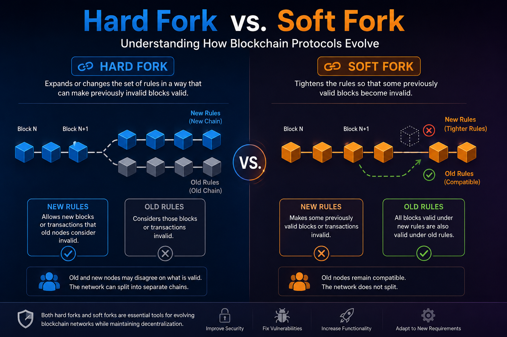

# Hard Fork vs. Soft Fork: Understanding How Blockchain Protocols Evolve

## Introduction

Blockchains are often described as immutable systems: once data is recorded, it cannot simply be rewritten. But **immutability does not mean that a blockchain protocol can never change**.

Blockchain networks sometimes need to introduce new rules, improve security, fix vulnerabilities, increase functionality, or adapt to new technical requirements. Because a decentralized network has no single administrator who can simply update every participant's software, changing the rules of a blockchain is a complex coordination problem.

Two of the most important mechanisms for changing blockchain consensus rules are:

* **Hard forks**
* **Soft forks**

Understanding the difference between them is essential for anyone studying blockchain technology because these mechanisms determine how nodes, miners or validators, developers, applications, and users respond to protocol changes.

The key difference can be summarized simply:

> **A hard fork expands or changes the set of rules in a way that can make previously invalid blocks valid, while a soft fork tightens the rules so that some previously valid blocks become invalid.**

But to truly understand this distinction, we first need to understand what a fork actually means.

---

# 1. What Is a Fork?

The word **fork** describes a situation in which a blockchain's history or consensus rules diverge.

In the context of protocol upgrades, a fork occurs when network participants begin operating according to different versions of the consensus rules.

A blockchain network is made up of many independent participants. Depending on the blockchain, these may include:

* Full nodes
* Miners
* Validators
* Wallets
* Exchanges
* Developers
* Applications

Full nodes independently verify whether blocks and transactions follow the network's consensus rules.

These rules determine things such as:

* Which transactions are valid
* Which blocks are valid
* How transactions are structured
* How blocks are structured
* How signatures are verified
* What scripts or instructions are permitted
* What consensus conditions must be satisfied

Therefore, changing the consensus rules is fundamentally different from simply releasing a new software version.

The important question is:

**Will nodes running the old rules still consider blocks created under the new rules valid?**

The answer to that question is what separates a hard fork from a soft fork.

---

# 2. What Are Consensus Rules?

Before discussing forks, it is important to understand **consensus rules**.

Consensus rules are the rules that blockchain nodes use to determine whether blocks and transactions are valid.

For example, in Bitcoin, a full node does not simply trust a miner because the miner produced a block.

Instead, the node independently checks the block against the protocol's rules.

Conceptually:

```text
Transaction
     ↓
Node verifies transaction
     ↓
Block is produced
     ↓
Node receives block
     ↓
Node verifies block
     ↓
Valid or Invalid
```

This is one of the fundamental properties of decentralized blockchains.

A miner or validator cannot simply announce:

> "This block is valid."

Other nodes must independently verify it.

Therefore, if developers change the rules, they are changing the conditions under which nodes determine whether blocks are valid.

That is where forks become important.

---

# 3. Hard Fork

A **hard fork** is a change to the consensus rules that is **not backward-compatible** with the old rules.

Under a hard fork, the new rules can allow blocks or transactions that old software considers invalid.

Bitcoin's developer documentation describes a hard fork as a situation where non-upgraded nodes cannot validate blocks produced according to the newer consensus rules.

The easiest way to understand this is:

> **A hard fork changes the rules so that old nodes and upgraded nodes may disagree about what is valid.**

---

# 4. A Simple Example of a Hard Fork

Imagine that a blockchain currently has this rule:

> A block can contain a maximum of 1 MB of data.

Now developers propose changing the rule:

> A block can contain up to 2 MB of data.

Suppose an upgraded miner creates a 1.5 MB block.

The upgraded node says:

```text
1.5 MB block
↓
New rules
↓
VALID
```

But an old node still follows the 1 MB rule:

```text
1.5 MB block
↓
Old rules
↓
INVALID
```

Now we have a compatibility problem.

The upgraded software considers the block valid.

The old software considers the same block invalid.

If enough participants continue following the old rules, the network can split into separate chains.

Conceptually:

```text
                 Block N
                    │
                    ▼
                 Block N+1
                    │
             ┌──────┴──────┐
             ▼             ▼
       Old-rule chain   New-rule chain
       Old nodes        Upgraded nodes
```

This is why a hard fork can potentially create a permanent chain split.

---

# 5. Why Is It Called "Hard"?

The word **hard** refers to the compatibility boundary.

Old software cannot simply continue operating normally while accepting everything produced under the new rules.

Participants generally need to upgrade their software if they want to follow the new consensus rules.

Bitcoin Core has described hard forks as changes that break compatibility with previous software and can require participants to upgrade to the new rules.

This does not mean that every hard fork automatically creates two permanent cryptocurrencies.

A hard fork **can** result in a chain split, but whether a permanent split occurs depends on whether participants continue supporting different rule sets.

So these two concepts should not be treated as identical:

**Hard fork ≠ automatically two permanent blockchains.**

A hard fork is primarily a **consensus-rule change**.

A permanent chain split is a possible consequence.

---

# 6. Soft Fork

A **soft fork** is also a change to the consensus rules, but it is designed to be **backward-compatible**.

A soft fork generally makes the valid set of blocks **more restrictive**.

In other words:

> **Some blocks that were previously valid become invalid, while blocks that were already invalid remain invalid.**

This is the defining property of a soft fork.

This creates an important compatibility advantage.

Old nodes may not understand the new rules, but they can often continue accepting blocks that comply with both the old and new rules.

---

# 7. A Simple Example of a Soft Fork

Imagine that the current blockchain rules say:

> Blocks may contain transactions using formats A, B, or C.

A protocol upgrade introduces a new rule:

> Format C is no longer allowed.

Now the valid set becomes:

```text
Before:

A ✓
B ✓
C ✓


After soft fork:

A ✓
B ✓
C ✗
```

Notice what happened.

The rules became **stricter**.

Nothing that was previously invalid suddenly became valid.

Instead, something that was previously valid became invalid.

That is the core idea behind a soft fork.

---

# 8. Why Can Old Nodes Continue Working?

This is one of the most important concepts to understand.

Suppose an old node does not understand the new restriction.

It might think:

```text
"This transaction is valid according to my rules."
```

But the upgraded nodes may say:

```text
"This transaction violates the new rules."
```

If upgraded miners or validators refuse to include such transactions in valid blocks, the old node may still accept the blocks that are produced.

Therefore, the blockchain can continue operating under a single chain even though some nodes do not understand the complete set of new restrictions.

This is why soft forks are considered backward-compatible.

Bitcoin's developer documentation explains that upgraded nodes can enforce stricter rules while non-upgraded nodes may continue accepting blocks that satisfy their older rules.

---

# 9. The Most Important Difference

The easiest way to remember the difference is to think about the **validity set**.

### Hard Fork

A hard fork can expand the set of blocks considered valid:

```text
OLD RULES

Valid blocks:
████████

New rules:

Valid blocks:
████████████

Some newly valid blocks
are rejected by old nodes.
```

### Soft Fork

A soft fork restricts the set of valid blocks:

```text
OLD RULES

Valid blocks:
████████████

New rules:

Valid blocks:
████████

Some previously valid blocks
are now rejected.
```

This gives us the fundamental rule:

> **Hard fork: previously invalid things can become valid.**

> **Soft fork: previously valid things can become invalid.**

---

# 10. Backward Compatibility

The concept of **backward compatibility** is at the heart of the difference.

A backward-compatible upgrade allows older software to continue interacting with the network without necessarily understanding every new rule.

### Soft Fork

```text
Old software
     │
     ├── understands old valid blocks
     │
     ▼
Continues operating
```

### Hard Fork

```text
New software
     │
     ├── follows new rules
     │
     ▼
May accept blocks
old software rejects
```

Therefore:

**Soft fork → backward-compatible**

**Hard fork → not backward-compatible**

This is why soft forks are generally considered easier to deploy safely in networks where not every participant upgrades simultaneously.

---

# 11. Do All Nodes Have to Upgrade?

This is another important distinction.

### Soft Fork

Not necessarily.

Old nodes can often continue operating because the new rules are designed to remain compatible with what they already consider valid.

However, upgrading is still important because old nodes may not fully understand or enforce the new security properties.

### Hard Fork

Generally, participants who want to follow the new consensus rules must upgrade.

If some participants refuse to upgrade, they may continue following the old rules.

That can result in:

```text
                 Network
                    │
             Protocol upgrade
                    │
          ┌─────────┴─────────┐
          ▼                   ▼
     Upgrade software     Keep old software
          │                   │
          ▼                   ▼
     New consensus        Old consensus
          │                   │
          └───────┬───────────┘
                  ▼
             Possible split
```

---

# 12. What Happens to the Blockchain During a Hard Fork?

Suppose a blockchain reaches block 1,000,000.

At this point, a hard fork activates.

Before the upgrade:

```text
Block 999,999
      ↓
Block 1,000,000
```

After the upgrade, participants may disagree about the next valid block.

The network can potentially develop two branches:

```text
                 Block 1,000,000
                        │
              ┌─────────┴─────────┐
              ▼                   ▼
       Block 1,000,001       Block 1,000,001
          Old rules             New rules
              │                   │
              ▼                   ▼
         Old-rule chain       New-rule chain
```

If the disagreement persists, both chains may continue independently.

This is the mechanism through which a hard fork can create separate blockchain networks.

---

# 13. What Happens During a Soft Fork?

A soft fork can also temporarily produce disagreement between nodes.

For example:

```text
Old node:
"This block is valid."

Upgraded node:
"This block is invalid."
```

However, the upgraded rules are designed so that blocks accepted by upgraded nodes remain within the old nodes' accepted set.

Therefore, if the network follows the new rules correctly, the chains can converge on one chain.

Conceptually:

```text
             New rules activated
                     │
                     ▼
              Network continues
                     │
          ┌──────────┴──────────┐
          ▼                     ▼
     Old nodes              New nodes
     accept block           accept block
          │                     │
          └──────────┬──────────┘
                     ▼
                Same chain
```

This compatibility is one of the major advantages of soft forks.

---

# 14. Soft Forks Can Introduce Powerful Changes

A common misconception is:

> "Soft forks are only for small changes."

That is not necessarily true.

A carefully designed soft fork can introduce significant functionality while maintaining backward compatibility.

One important historical example is **Segregated Witness (SegWit)** in Bitcoin.

SegWit was deployed as a soft fork and changed the way transaction witness data was committed and represented within blocks. Its design specifically included mechanisms for maintaining soft-fork compatibility.

This demonstrates an important principle:

> The difference between a hard fork and soft fork is not simply how large the upgrade is.

The key question is:

**Does the new consensus rule remain compatible with the old definition of validity?**

---

# 15. Why Do Blockchains Need Forks?

Blockchain protocols evolve for many reasons.

### 1. Security

Developers may discover vulnerabilities or weaknesses in existing rules.

A protocol upgrade can introduce stricter validation requirements.

### 2. New functionality

Developers may want to add new capabilities to the protocol.

### 3. Scalability

Networks may need changes that improve transaction processing or resource utilization.

### 4. Efficiency

Consensus rules or transaction structures can sometimes be redesigned to use network resources more efficiently.

### 5. Bug fixes

Consensus-critical bugs can require protocol changes.

### 6. Economic changes

Some upgrades can modify protocol-level economic mechanisms.

### 7. Long-term protocol evolution

Blockchain protocols are not static pieces of software.

They must evolve while maintaining network security and decentralized consensus.

Ethereum, for example, regularly performs protocol upgrades that introduce changes to functionality, security, and performance. Its protocol-upgrade process includes preparation and testing across development networks, testnets, and mainnet.

---

# 16. How Are Forks Activated?

A protocol upgrade needs an activation mechanism.

Different blockchain networks use different approaches.

In Bitcoin's history, soft forks have been activated using mechanisms including:

* **Flag-day activation**
* **Miner signaling**
* **User Activated Soft Forks (UASF)**
* Other deployment mechanisms

Bitcoin's developer documentation describes both User Activated Soft Forks and Miner Activated Soft Forks as historical activation approaches.

The general process looks something like this:

```text
Protocol improvement proposed
            ↓
Specification created
            ↓
Implementation developed
            ↓
Testing
            ↓
Community / ecosystem coordination
            ↓
Activation condition
            ↓
New consensus rules enforced
```

Different blockchains implement this process differently.

---

# 17. Hard Forks and Soft Forks Are Not the Same as Software Forks

The word **fork** can be confusing because it is used in several different contexts.

A **software fork** can simply mean that developers copy an existing codebase and continue developing it separately.

A **consensus fork**, however, concerns the rules used to determine blockchain validity.

These concepts should not be confused.

For example:

```text
Software fork
= A development/codebase divergence

Consensus fork
= A divergence caused by different consensus rules
```

A developer can fork a blockchain's source code without creating a blockchain hard fork.

Likewise, a blockchain can undergo a protocol upgrade without the developers permanently creating a separate codebase.

---

# 18. Hard Fork vs. Soft Fork: The Core Difference

Instead of memorizing complicated definitions, remember this:

### Hard Fork

The new rules can accept something the old rules reject.

```text
Old:
❌ X

New:
✅ X
```

Old nodes reject it.

Therefore, compatibility is broken.

### Soft Fork

The new rules reject something the old rules accepted.

```text
Old:
✅ X

New:
❌ X
```

Old nodes can still recognize the remaining valid blocks.

Therefore, compatibility can be maintained.

This is the most important mental model for understanding forks.

---

# 19. A Real-World Analogy

Imagine a university has a rule:

> Students can enter an exam room if they have a student ID.

Now the university introduces a new rule.

### Hard Fork Analogy

The university changes the rule:

> Students can enter with either a student ID or a government ID.

The old security system only understands student IDs.

A student using a government ID is accepted by the new system but rejected by the old system.

The new rules expanded what is considered valid.

That's similar to a **hard fork**.

---

### Soft Fork Analogy

Instead, the university changes the rule:

> Students must have a student ID **and** be wearing their official uniform.

The old security system does not understand the new uniform requirement, but students who satisfy the new rule still satisfy the old rule.

The new rules became stricter.

That's similar to a **soft fork**.

---

# 20. Can a Soft Fork Create a Chain Split?

Yes, at least temporarily.

It is a common misconception that soft forks can never cause forks.

They can.

If some miners or validators produce blocks that violate the new rules, upgraded nodes may reject those blocks while old nodes accept them.

This can temporarily create different views of the chain.

However, the purpose of the soft-fork design is to allow the network to converge on a chain that satisfies the stricter rules.

Bitcoin's developer documentation explicitly discusses temporary divergence and how upgraded nodes can enforce the new rules while maintaining compatibility with older nodes.

Therefore:

**Soft fork does not mean "fork can never happen."**

It means:

**The consensus-rule change is designed to be backward-compatible.**

---

# 21. Can a Hard Fork Happen Without Creating Two Permanent Chains?

Yes.

A hard fork is a change to consensus rules, not a guarantee that two permanent chains will survive.

Imagine almost every participant agrees to the upgrade.

Everyone upgrades their software.

The new rules activate.

If nobody continues operating an alternative chain under the old rules, there may be no meaningful long-term chain split.

So:

> **A hard fork can create a permanent chain split, but it does not have to.**

The possibility of a permanent split exists because old and new rules are incompatible.

---

# 22. What Happens to Users During a Hard Fork?

Users can be affected significantly.

If a hard fork results in two independent chains, users may find that their assets exist on both chains at the point of divergence.

For example:

```text
Before fork:

User balance
    ↓
100 coins

              Fork
                │
        ┌───────┴───────┐
        ▼               ▼
    Chain A          Chain B
    100 coins        100 coins
```

This does **not** necessarily mean the user suddenly became economically twice as wealthy.

The two assets now belong to different networks with different consensus rules, markets, security assumptions, and communities.

Their economic value can be completely different.

This is one reason hard forks require careful coordination.

---

# 23. The Role of Nodes

Nodes are extremely important in forks because they enforce consensus rules.

A simplified model is:

```text
              Blockchain
                   │
                   ▼
                 Block
                   │
                   ▼
              Full Node
                   │
          Verify consensus rules
                   │
          ┌────────┴────────┐
          ▼                 ▼
        Valid             Invalid
          │                 │
          ▼                 ▼
       Accept             Reject
```

When a protocol upgrade changes consensus rules, the software running on nodes must reflect those rules.

Therefore, the actual implementation of the protocol matters enormously.

A blockchain's consensus is not simply whatever developers write in a document.

It emerges from the combination of:

* Protocol rules
* Software implementations
* Nodes
* Validators/miners
* Economic participants
* Users
* Social coordination

---

# 24. Why Soft Forks Are Often Preferred

Soft forks have an important advantage:

**They can preserve backward compatibility.**

This can make them less disruptive than hard forks.

Bitcoin Core has historically argued that soft forks are generally preferable because they allow old and new software to coexist and reduce the disruption associated with mandatory upgrades.

However, this does not mean:

> Soft fork = always better.

A hard fork can sometimes be appropriate when the desired protocol change cannot reasonably be implemented as a soft fork.

The correct choice depends on the technical requirements and governance model of the blockchain.

---

# 25. The Trade-Off

A useful way to think about the trade-off is:

```text
Soft Fork
   ↓
Stricter rules
   ↓
Backward compatibility
   ↓
Less disruptive upgrades

Hard Fork
   ↓
Broader / incompatible rules
   ↓
Requires coordination
   ↓
Potential chain split
```

Neither mechanism is inherently "good" or "bad."

They are different tools for changing consensus rules.

---

# 26. Hard Fork vs. Soft Fork: The Difference in Plain English

The table above can be confusing if you are seeing these concepts for the first time. So let's forget the technical terms for a moment and look at the difference step by step.

Imagine that a blockchain currently has a set of rules called **Old Rules**.

## Hard Fork: The New Rules Accept Something the Old Rules Reject

Suppose the old rules say:

```text
Old Rules:
1 MB maximum block size
```

Now the new rules say:

```text
New Rules:
2 MB maximum block size
```

An upgraded node can therefore accept a 1.5 MB block:

```text
1.5 MB block
      ↓
New rules
      ↓
    VALID ✓
```

But an old node sees the same block differently:

```text
1.5 MB block
      ↓
Old rules
      ↓
   INVALID ✗
```

So the important point is:

> **A hard fork can make something valid that was previously invalid.**

Because old nodes reject something that new nodes accept, the old and new software are no longer fully compatible.

## Soft Fork: The New Rules Reject Something the Old Rules Accepted

Now imagine the old rules allow three transaction types:

```text
Old Rules:
A ✓
B ✓
C ✓
```

The new rules decide that transaction type C is no longer allowed:

```text
New Rules:
A ✓
B ✓
C ✗
```

Here, nothing new became valid. Instead, the rules became stricter.

So:

> **A soft fork can make something invalid that was previously valid.**

The important advantage is that blocks following the new, stricter rules still fit inside what old nodes consider valid.

## The Easiest Way to Remember It

Don't memorize the whole table. Remember these two sentences:

```text
HARD FORK
Old rules:  ✗ X
New rules:  ✓ X

Something that was invalid becomes valid.
```

```text
SOFT FORK
Old rules:  ✓ X
New rules:  ✗ X

Something that was valid becomes invalid.
```

And this leads directly to the compatibility difference:

```text
Hard Fork
New rules accept something old nodes reject
                    ↓
          Compatibility breaks

Soft Fork
New rules reject something old rules accepted
                    ↓
       Backward compatibility is possible
```

That is the core difference between a hard fork and a soft fork. Once you understand this, the rest of the terminology becomes much easier.

---

# 27. The Mathematical View

We can make the difference even clearer by thinking about sets.

Let:

**V_old**

represent all blocks considered valid under the old consensus rules.

For a soft fork:

**V_new ⊆ V_old**

The new rules accept a subset of what the old rules accepted.

For a hard fork, the relationship is not restricted in this way. The new rules may accept blocks that were previously invalid.

For example:

```text
Soft Fork:

V_old = {A, B, C, D, E}

V_new = {A, B, C}

V_new ⊆ V_old
```

The rules became stricter.

A hard fork might instead produce:

```text
V_old = {A, B, C}

V_new = {A, B, C, D}

D was previously invalid.
D is now valid.
```

Old nodes reject D.

New nodes accept D.

That is the fundamental technical distinction.

---

# 28. Common Misconceptions

## Misconception 1: Every fork creates a new cryptocurrency

False.

A fork in consensus rules does not automatically create a separate cryptocurrency.

A permanent split requires participants to continue following different chains.

---

## Misconception 2: Every hard fork creates two chains

False.

A hard fork can happen without a permanent chain split if participants coordinate around the new rules.

---

## Misconception 3: A soft fork requires nobody to upgrade

Not exactly.

A soft fork is backward-compatible by design, but upgrading remains important for participants who want to enforce the new rules themselves.

---

## Misconception 4: Soft forks are smaller than hard forks

Not necessarily.

The size or importance of an upgrade does not determine whether it is a hard fork or soft fork.

The key issue is **compatibility of consensus rules**.

---

## Misconception 5: A software update is automatically a fork

No.

A normal software update can change interfaces, performance, or features without changing consensus rules.

A fork specifically concerns a change in the rules that determine blockchain validity.

---

# 29. Why Understanding Forks Matters

Forks are not just technical terminology.

They reveal something fundamental about how decentralized networks work.

In a centralized system, an organization can often say:

> "Everyone must use version 2.0."

In a decentralized blockchain, there is no universal administrator with the authority to force every independent node to run a particular version.

Instead:

```text
Developers propose change
        ↓
Software implements change
        ↓
Participants choose software
        ↓
Nodes enforce rules
        ↓
Network coordinates
        ↓
Consensus emerges
```

This is why protocol upgrades are as much about **coordination** as they are about code.

---

# 30. The Deeper Lesson: Blockchains Are Social + Technical Systems

One of the most important lessons from hard forks and soft forks is that blockchain consensus is not purely mathematical.

The software defines rules.

Nodes enforce rules.

Miners or validators produce blocks.

Users choose which software and networks to support.

Exchanges and applications integrate with particular chains.

Developers propose improvements.

All of these actors influence whether an upgrade becomes successful.

Therefore, a blockchain protocol upgrade is ultimately a coordination process involving both:

**Technology + People**

This is one reason controversial hard forks can become major historical events.

---

# 31. A Simple Mental Model to Remember Everything

If you remember only one diagram from this article, remember this:

```text
                 CONSENSUS RULE CHANGE
                         │
             ┌───────────┴───────────┐
             │                       │
             ▼                       ▼
        HARD FORK                SOFT FORK
             │                       │
             ▼                       ▼
   Rules can become broader     Rules become stricter
             │                       │
             ▼                       ▼
 Previously invalid things     Previously valid things
   may become valid             may become invalid
             │                       │
             ▼                       ▼
 Old software may reject       Old software can often
 new valid blocks               accept the new chain
             │                       │
             ▼                       ▼
 Compatibility broken          Backward compatible
             │                       │
             ▼                       ▼
 Potential permanent           Generally easier
 chain split                    to coordinate
```

---

# 32. The One-Sentence Definition

If someone asks you:

**"What is a hard fork?"**

You can answer:

> **A hard fork is a consensus-rule change that is not backward-compatible, meaning upgraded nodes may accept blocks that old nodes reject.**

And if they ask:

**"What is a soft fork?"**

You can answer:

> **A soft fork is a backward-compatible consensus-rule change that makes the set of valid blocks more restrictive.**

---

# 33. Final Conclusion

Hard forks and soft forks are mechanisms for evolving blockchain consensus rules.

The difference is fundamentally about **what happens to the definition of validity**.

A **hard fork** changes the rules in a way that can make previously invalid blocks valid. Because old nodes may reject those blocks, the new rules are not backward-compatible and can result in a permanent chain split if participants continue following different rule sets.

A **soft fork**, on the other hand, tightens the consensus rules. Some blocks that were previously valid become invalid, but the new valid blocks remain compatible with the old definition of validity. This allows upgraded and non-upgraded nodes to coexist more easily.

The simplest way to remember the entire concept is:

> **Hard fork = the rules can accept more than before.**

> **Soft fork = the rules accept less than before.**

And the deeper lesson is even more important:

> **A blockchain does not evolve simply because developers release new code. It evolves when enough network participants coordinate around a new set of consensus rules.**

That is what makes blockchain upgrades fundamentally different from ordinary software updates.

---

## Key Takeaways

* A fork can involve a divergence in blockchain consensus rules.
* Consensus rules determine which blocks and transactions are valid.
* A **hard fork** is not backward-compatible.
* A hard fork can make previously invalid blocks valid.
* Old nodes may reject blocks created under new hard-fork rules.
* A hard fork can potentially produce a permanent chain split.
* A **soft fork** is designed to be backward-compatible.
* A soft fork makes the consensus rules more restrictive.
* Some previously valid blocks become invalid under a soft fork.
* Soft forks can introduce substantial protocol functionality.
* Segregated Witness (SegWit) is a major historical example of a Bitcoin soft fork.
* A protocol upgrade is both a technical and coordination challenge.
* **Hard fork = incompatible rule expansion/change.**
* **Soft fork = compatible rule tightening.**

If you understand **what happens to the set of valid blocks**, you understand the fundamental difference between a hard fork and a soft fork.
