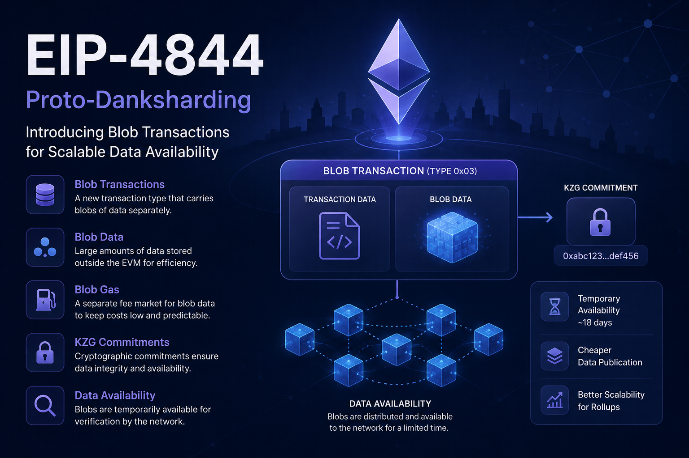

# EIP-4844: Proto-Danksharding and the Introduction of Blob Transactions

Ethereum has always faced a fundamental scalability problem: the network has limited block space, while the demand for transactions continues to grow.

Layer 2 Rollups helped Ethereum process much more activity by moving execution away from the main chain. However, Rollups still need to publish transaction data to Ethereum, and that data can become one of their biggest costs.

**EIP-4844** was introduced to solve this problem.

Also known as **Proto-Danksharding**, EIP-4844 introduced a new type of transaction and a new form of temporary data storage called **blobs**, providing a much cheaper way for Rollups to publish data to Ethereum. It was activated as part of the **Dencun upgrade**.

---

## The Problem EIP-4844 Solves

Before EIP-4844, Rollups mainly used Ethereum's transaction calldata to publish their data.

Calldata has an important property: it becomes part of Ethereum's permanent blockchain history.

That is useful for long-term availability, but it also makes calldata relatively expensive for large amounts of Rollup data.

The result was a scalability bottleneck:

```text
More Rollup Transactions
        ↓
More Data Published to Ethereum
        ↓
More Calldata
        ↓
Higher L1 Costs
        ↓
Higher Rollup Fees
```

Ethereum needed a mechanism specifically optimized for **large amounts of temporary data**.

That is the role of EIP-4844.

---

# What Is EIP-4844?

EIP-4844 is an Ethereum Improvement Proposal that introduced **blob-carrying transactions**.

These transactions allow users or applications, especially Rollups, to attach large pieces of data called **blobs** to transactions.

Unlike normal calldata, blob data is:

* Separate from EVM execution data
* Priced through a separate fee market
* Intended to be temporary
* Designed primarily for Rollup data

The EIP therefore creates a new transaction type:

```text
Transaction Type
      ↓
Blob Transaction
      ↓
Transaction + Blob References
```

The transaction type introduced by EIP-4844 is **Type 3**, represented by transaction type byte `0x03`.

---

# What Is a Blob?

The word **blob** stands for **Binary Large Object**.

In Ethereum, a blob is a relatively large piece of data associated with a blob transaction.

The important point is that the EVM does not directly read the contents of the blob during normal contract execution.

Instead, Ethereum records cryptographic commitments to the blobs, while the actual blob data is handled by the consensus layer and propagated separately.

A simplified architecture looks like this:

```text
                Blob Transaction
                       │
            ┌──────────┴──────────┐
            ↓                     ↓
      Execution Data          Blob Data
            │                     │
            ↓                     ↓
          EVM                Consensus Layer
```

This separation is one of the most important ideas introduced by EIP-4844.

---

# Why Not Simply Increase Calldata?

Ethereum could have simply reduced the cost of calldata.

However, this would increase pressure on the permanent blockchain history.

Every byte of calldata contributes to data that nodes need to preserve as part of Ethereum's historical blockchain data.

EIP-4844 takes a different approach.

Instead of making permanent data cheaper, it introduces a separate data channel designed for information that needs to be available for a limited period.

```text
Calldata
→ Permanent blockchain history

Blob
→ Temporary data availability
```

Ethereum's documentation describes blobs as a cheap way to publish temporary data, with an initial availability period of roughly 18 days.

---

# How Blob Transactions Work

A blob transaction contains normal transaction fields plus additional blob-related information.

Among those fields are:

```text
max_fee_per_blob_gas
blob_versioned_hashes
```

The `blob_versioned_hashes` field contains cryptographic references to the blobs associated with the transaction.

The simplified process is:

```text
Rollup
  ↓
Collect Transactions
  ↓
Compress / Encode Data
  ↓
Create Blob
  ↓
Create KZG Commitment
  ↓
Blob Transaction
  ↓
Ethereum
```

The Rollup does not ask Ethereum's EVM to execute the blob contents.

Instead, Ethereum provides a mechanism for making the data available and cryptographically linking it to the transaction.

---

# KZG Commitments

EIP-4844 relies on **KZG commitments** to cryptographically commit to blob data.

A simplified view is:

```text
Blob
 ↓
KZG Commitment
 ↓
Versioned Hash
 ↓
Included in Transaction
```

The commitment provides a compact cryptographic representation of the blob.

Ethereum can then verify that the supplied blob corresponds to the commitment associated with the transaction.

This is important because Ethereum does not need to put the entire blob directly inside the EVM execution payload.

KZG is therefore an important bridge between the large blob data and the compact information referenced by the execution layer.

---

# Blob Data Is Not Normal EVM Data

This distinction is extremely important for developers.

When a smart contract receives normal calldata:

```text
Transaction
    ↓
Calldata
    ↓
EVM
    ↓
Smart Contract
```

With blobs, the model is different:

```text
Blob Transaction
      ↓
Blob Data
      ↓
Consensus Layer
```

The EVM does not directly access the contents of a blob.

Instead, the execution layer has access to the blob's cryptographic commitment through the transaction's blob-related fields.

This makes blobs suitable for **data publication**, rather than general-purpose contract storage.

---

# A Separate Blob Fee Market

Another major feature of EIP-4844 is that blobs have their own fee market.

Ethereum already has an execution gas market.

EIP-4844 introduces a separate resource:

**Blob Gas**

This means Ethereum now distinguishes between:

```text
Execution Gas
→ Cost of EVM computation

Blob Gas
→ Cost of using blob data capacity
```

A blob transaction therefore has a separate parameter called:

```text
max_fee_per_blob_gas
```

The blob fee market uses a mechanism similar in spirit to EIP-1559, where the blob base fee changes depending on network demand.

---

# Why Separate Blob Gas?

Imagine that Ethereum has plenty of computational capacity but blobs are heavily used.

If blob data shared exactly the same fee market as execution, congestion in one resource could interfere with pricing of another.

EIP-4844 separates them:

```text
Ethereum Resources
       │
       ├── Execution Gas
       │
       └── Blob Gas
```

Now the price of executing EVM operations and the price of publishing blob data can respond independently to demand.

This is an important architectural improvement.

---

# Blob Gas and Excess Blob Gas

The blob fee market introduces several important concepts.

The two you will encounter most often are:

```text
blobGasUsed
excessBlobGas
```

### blobGasUsed

`blobGasUsed` records how much blob gas was consumed by blob transactions included in a block.

### excessBlobGas

`excessBlobGas` tracks accumulated blob demand above the target.

The relationship can be simplified as:

```text
Blob Usage
    ↓
blobGasUsed
    ↓
Compare with Target
    ↓
excessBlobGas
    ↓
Blob Base Fee Adjustment
```

When demand for blob space becomes high, the blob base fee rises, making blob usage more expensive and helping regulate demand.

---

# Why Are Blobs Temporary?

One of the most interesting design decisions of EIP-4844 is that blobs are **not permanent blockchain storage**.

Ethereum currently specifies a minimum blob sidecar retrieval period of 4096 epochs, approximately 18 days. After that, blob data can be pruned from clients.

Why is this useful?

Because Rollups generally need their data to be available for verification and recovery purposes, but they do not necessarily need every raw piece of data to remain inside every Ethereum node forever.

This produces a useful compromise:

```text
Permanent History
      ↓
Expensive

Temporary Availability
      ↓
Much Cheaper
```

---

# Why Rollups Benefit From EIP-4844

This is where EIP-4844 becomes particularly important.

A Rollup can process many transactions outside Ethereum and then publish the relevant data to Ethereum using blobs.

The flow becomes:

```text
Users
  ↓
Rollup
  ↓
Execute Transactions
  ↓
Compress Data
  ↓
Blob
  ↓
Ethereum
```

Instead of paying the cost of putting all that data into permanent calldata, the Rollup uses the dedicated blob mechanism.

This significantly reduces the data publication cost for Rollups and is one of the main reasons EIP-4844 was introduced.

---

# EIP-4844 and Data Availability

EIP-4844 is closely connected to the concept of **Data Availability**.

The goal is not permanent storage.

The goal is to ensure that the required Rollup data is available to participants for the period in which it is needed.

Conceptually:

```text
Rollup Data
     ↓
Blob
     ↓
Ethereum
     ↓
Data Available
     ↓
Participants Can Verify / Reconstruct
```

This makes EIP-4844 an important part of Ethereum's broader Data Availability architecture.

---

# Blob Sidecars

There is another technical concept worth understanding: the **blob sidecar**.

Rather than embedding the complete blob contents directly inside the beacon block body, Ethereum propagates blobs separately as sidecars.

A simplified structure is:

```text
Beacon Block
 ├── Block Data
 ├── Blob Commitments
 └── References

Blob Sidecars
 ├── Blob
 ├── KZG Commitment
 └── KZG Proof
```

This design helps separate the handling of execution payloads from large blob data and also prepares Ethereum's architecture for future Data Availability Sampling.

---

# EIP-4844 Is Not Full Danksharding

The name **Proto-Danksharding** is important.

EIP-4844 is not full Danksharding.

It can be understood as an intermediate step toward a larger Data Availability scaling design.

EIP-4844 introduces:

```text
Blob Transactions
+
Blob Fee Market
+
KZG Commitments
+
Blob Sidecars
```

But it does not yet provide the full Data Availability Sampling architecture envisioned for much larger-scale sharding.

The original EIP explicitly describes itself as a stop-gap implementation that introduces the transaction format expected to be used for future sharding.

---

# EIP-4844 vs Danksharding

The easiest way to remember the relationship is:

```text
EIP-4844
   ↓
Proto-Danksharding
   ↓
Blob Infrastructure
   ↓
Future Scaling
   ↓
Danksharding
```

EIP-4844 established the infrastructure needed to significantly increase the amount of Rollup data Ethereum can handle.

Future scaling upgrades can then build on this foundation.

---

# A Developer's Mental Model

As a blockchain developer, you don't need to memorize every parameter of EIP-4844.

You should understand this model:

```text
Ethereum L1
│
├── Execution
│    └── Gas
│
└── Blob Data
     ├── Blob Gas
     ├── KZG Commitment
     ├── Temporary Availability
     └── Rollup Data
```

This mental model will make later concepts such as:

```text
blobGasUsed
excessBlobGas
KZG
Data Availability Sampling
PeerDAS
Danksharding
```

much easier to understand.

---

# The Bigger Impact of EIP-4844

EIP-4844 changed Ethereum's scaling architecture in an important way.

Before it, Rollups had to rely heavily on existing Ethereum data mechanisms.

After EIP-4844, Ethereum provides a dedicated resource specifically designed for the data needs of Rollups.

The result is:

```text
Rollups
   ↓
Lower Data Publication Costs
   ↓
Lower L2 Fees
   ↓
More Affordable Transactions
   ↓
Greater Ethereum Scalability
```

Ethereum therefore becomes less dependent on making the execution layer itself handle every piece of scaling demand.

---

# Conclusion

**EIP-4844 introduced a dedicated, temporary data-availability mechanism for Ethereum, primarily designed to make Rollup data significantly cheaper to publish.**

Its most important innovations are:

```text
Blob Transactions
        ↓
Blob Data
        ↓
Separate Blob Fee Market
        ↓
Blob Gas
        ↓
KZG Commitments
        ↓
Temporary Data Availability
```

EIP-4844 does not make Ethereum execute more transactions directly.

Instead, it makes it much cheaper for **Rollups to publish the data they need**, allowing the Ethereum ecosystem to scale while keeping permanent blockchain growth more manageable.

The key idea to remember is:

> **EIP-4844 separates large, temporary data from Ethereum's permanent execution data and gives that data its own scalable fee market.**

That seemingly simple change is one of the fundamental building blocks of Ethereum's modern scaling architecture.
