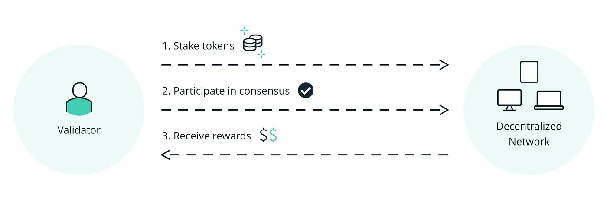
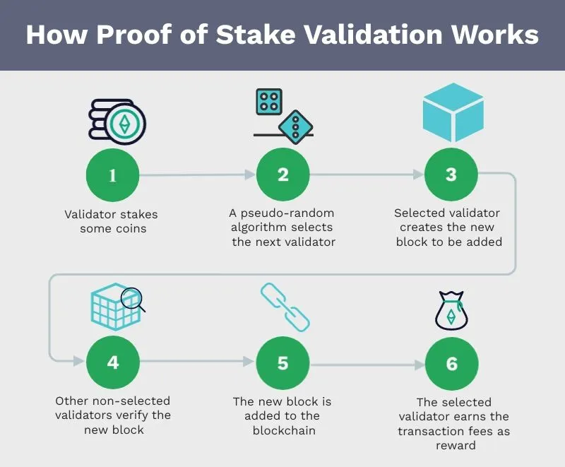

# Consensus Mechanism (Proof of Stake) — PoS

The Proof of Stake (PoS) consensus mechanism is one of the popular methods for verifying and securing transactions in blockchains. Unlike Proof of Work (PoW), which requires high processing power and energy consumption to verify transactions, PoS uses validators to verify blocks instead of relying on miners.

## General Principles of the Proof of Stake (PoS) Mechanism

In PoS, instead of miners, validators are responsible for validating transactions and creating new blocks. Anyone who wants to become a network validator must lock a certain amount of the same network’s digital currency as stake in the network. These shares usually act as collateral that encourages validators to behave honestly.

## Consensus Process Steps in PoS

1. **Stake Lock:** To become a validator, a person must lock a certain amount of network tokens. This amount is considered the collateral or “stake” of the validator.
2. **Validation Selection:** The network randomly or based on various factors, such as the amount of stake, selects validators to confirm and create blocks.
3. **Create a Block:** The selected validator gets the right to create a new block. This validator collects network transactions, puts them into a new block, and proposes the block to the network.
4. **Block Validation:** After the block is created, other validators check it. If the required validators vote for the block’s correctness, the block is considered valid and added to the blockchain.
5. **Reward Distribution:** The validator who created the new block receives a reward for participating. This is typically awarded in the form of native network tokens, and other validators who participate in validation may also be rewarded.
6. **Slashing:** If validators behave dishonestly or attempt to commit fraud, the network can confiscate part or all of their staked collateral. This process is known as slashing and is designed to discourage malicious behavior and increase network security.
7. **Unstaking:** After a certain period, validators can unlock their stake if they wish. In some networks, there may be a withdrawal period before the stake can be withdrawn.

These steps help PoS verify and record transactions in a decentralized, secure, and less energy-intensive manner than PoW.

## Consensus Mechanism (Proof of Stake) — PoS

1. **Reduced Energy Consumption:** PoS consumes much less energy than PoW, as there is no need to compete using high computing power.
2. **Better Scalability:** By reducing the need for processing power, PoS can support increased speed and lower transaction costs.
3. **Decentralization:** Due to the participation of more users in staking and the lack of specialized mining equipment, decentralization may improve in PoS networks.

## Disadvantages of Proof of Stake (PoS)

**The “rich get richer” issue:** People with more tokens may have a higher chance of being selected as validators, which can exacerbate the concentration of wealth.
