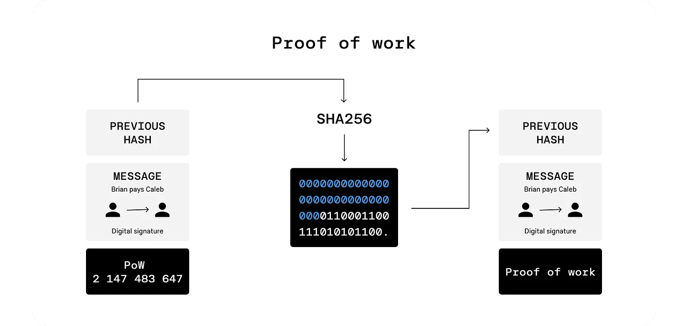
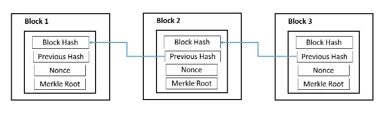

# Consensus Mechanism (Proof of Work) — PoW

[Read the original article on Medium](https://medium.com/@0xsix9/consensus-mechanism-proof-of-work-pow-e0862e642c5a)

In the POW mechanism, validators (miners) compete with each other to solve a complex mathematical problem that requires high computing power. This process is known as mining. The first miner who can solve the problem gets the right to add a new block to the chain and receives a reward.

### Notes about this consensus mechanism

1. **High energy consumption:** The reason for the need for high computing power is that mining is associated with high energy consumption.
2. **High security:** POW is resistant to attacks because it requires huge computing power to attack the network.
3. **Low speed of transactions:** The time required to solve math problems and create a new block slows down the verification of transactions.

**The POW algorithm is used in the Bitcoin blockchain and ensures the security of the network. In the emerging blockchain, this consensus mechanism is not used to ensure security.**

## Proof of Work (PoW)

This image shows the steps of the Proof of Work (POW) process in a blockchain network. In this process, a transaction along with certain data (such as the hash of the previous block) is entered into the SHA-256 hashing algorithm to generate a new hash. The following is a more detailed explanation of the steps.

### Previous Hash

This value represents the hash of the previous block in the blockchain chain. Each block contains the hash of the previous block to create a connection between the blocks and ensure the security of the chain.

### Message

This section indicates the transaction that needs to be confirmed. In the example, we see the transaction “Brian pays Caleb”, which means “Brian makes a payment to Caleb”. This transaction has a digital signature that ensures its validity and authenticity.

### Hash Calculation With SHA-256

The data, including the previous block’s hash information and transaction information, is fed into the SHA-256 algorithm to generate a new hash. The hash output must be a specific value, which usually must start with a certain number of zeros, which is called the network difficulty.

### Amount of (Nance)

To obtain the desired hash, a special value called Nance is added to the original data and is changed until the generated hash matches the specified criteria (such as the number of leading zeros). In the image, the number “2147483647” is displayed as the nonce that the miners found to arrive at the desired hash.

### Confirm and Add a New Block

After calculating the desired hash, this block is added to the blockchain chain and its hash is stored as the hash of the next block in the chain. This mechanism makes each block dependent on its previous block and manipulation of previous data becomes almost impossible.

---

**Source:** [Consensus Mechanism (Proof of Work) — POW](https://medium.com/@0xsix9/consensus-mechanism-proof-of-work-pow-e0862e642c5a)
