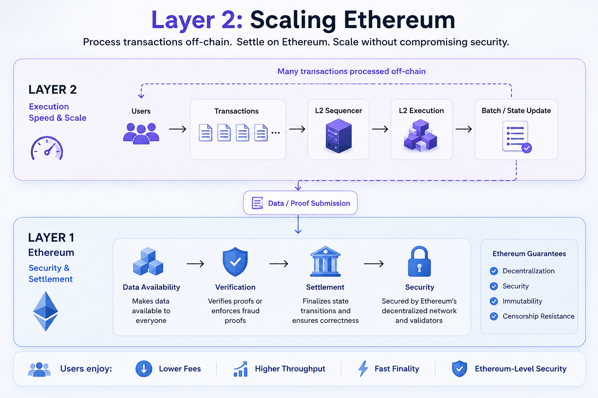

# Layer 2: How Ethereum Scales Beyond the Main Chain

Ethereum is one of the most widely used blockchain platforms for smart contracts and decentralized applications. However, Ethereum's main network has limited capacity.

When many users compete for the same block space, transaction fees can increase and transactions can become slower or more expensive.

To solve this scalability problem, the Ethereum ecosystem has developed **Layer 2 (L2)** networks.

Layer 2 allows transactions to be processed outside Ethereum's main execution environment while still using Ethereum as the underlying security and settlement layer.

---

## What Is Layer 2?

**Layer 2** refers to blockchain networks or protocols built on top of Ethereum that process transactions separately from Ethereum's main execution layer.

The basic idea is:

```text
User
 ↓
Layer 2
 ↓
Transactions are processed
 ↓
Data / proofs are submitted to Ethereum
 ↓
Ethereum provides settlement and security
```

Instead of forcing Ethereum to execute every transaction itself, Layer 2 networks handle a large portion of transaction execution.

This allows the Ethereum ecosystem to process significantly more activity.

---

# Why Does Ethereum Need Layer 2?

Ethereum has limited block space.

Every block can only contain a certain amount of computational work and data.

When demand exceeds available capacity:

```text
High Demand
     ↓
Limited Block Space
     ↓
Competition for Block Space
     ↓
Higher Gas Fees
```

Simply increasing Ethereum's block size would make running a full node more expensive and could negatively affect decentralization.

Layer 2 takes a different approach.

Instead of making Ethereum execute every transaction, L2 networks move much of the execution away from Ethereum.

---

# Layer 1 vs Layer 2

Ethereum itself is commonly referred to as **Layer 1 (L1)**.

Layer 2 networks operate on top of it.

A simplified model looks like this:

```text
        Layer 2
   ┌───────────────┐
   │ Transactions  │
   │   Execution   │
   └───────┬───────┘
           ↓
        Ethereum
        Layer 1
   ┌───────────────┐
   │ Settlement    │
   │ Security      │
   │ Data           │
   └───────────────┘
```

The important idea is that L2 does not completely replace Ethereum.

Instead, it uses Ethereum as a foundation.

---

# How Does Layer 2 Work?

A Layer 2 network can process many transactions away from Ethereum's main execution environment.

It then periodically submits information back to Ethereum.

For example:

```text
Transaction 1 ─┐
Transaction 2 ─┤
Transaction 3 ─┤
Transaction 4 ─┤
Transaction 5 ─┘
       ↓
   Layer 2
       ↓
Transactions processed
       ↓
Batch / Proof
       ↓
Ethereum
```

Instead of Ethereum processing every individual transaction, many transactions can be grouped together.

This is one of the main reasons L2 can reduce the cost per transaction.

---

# What Is a Rollup?

One of the most important types of Layer 2 is the **Rollup**.

A Rollup executes transactions outside Ethereum and then publishes information back to Ethereum.

There are two major types:

```text
Rollups
   │
   ├── Optimistic Rollups
   │
   └── ZK Rollups
```

The two approaches use different mechanisms to convince Ethereum that the Layer 2 state is valid.

---

# Optimistic Rollups

Optimistic Rollups generally assume that submitted transactions are valid unless someone proves otherwise.

The system can process transactions on Layer 2 and periodically submit the resulting state information to Ethereum.

If someone believes that an invalid state transition was submitted, they can challenge it using a **fraud-proof mechanism**.

The basic idea is:

```text
L2 Transactions
      ↓
L2 Execution
      ↓
State Update
      ↓
Ethereum
      ↓
Challenge Period
      ↓
Fraud Proof if necessary
```

This approach allows large amounts of transaction execution to happen outside Ethereum.

---

# ZK Rollups

ZK Rollups use **zero-knowledge proofs** to demonstrate that a set of Layer 2 transactions was processed correctly.

Instead of relying primarily on a challenge period, a ZK Rollup generates a cryptographic proof of correct execution.

Conceptually:

```text
L2 Transactions
      ↓
L2 Execution
      ↓
Generate ZK Proof
      ↓
Submit Proof to Ethereum
      ↓
Ethereum Verifies Proof
```

If the proof is valid, Ethereum can accept the corresponding state transition.

---

# Where Does Ethereum Come In?

A common misconception is that Layer 2 completely operates independently from Ethereum.

It does not.

Ethereum can provide several important functions for an L2, including:

* Settlement
* Data availability
* Verification
* Security

This relationship is what makes Ethereum-based Layer 2 networks different from simply creating an independent blockchain.

---

# Data Availability

One of the most important concepts for understanding Layer 2 is **Data Availability**.

Suppose an L2 processes thousands of transactions.

Other participants may need access to the relevant transaction data to reconstruct or verify the L2 state.

Therefore, the required data must be made available somewhere.

Ethereum can act as the underlying data availability layer.

The simplified architecture becomes:

```text
Layer 2
   ↓
Process Transactions
   ↓
Publish Required Data
   ↓
Ethereum
   ↓
Data Availability
```

This is particularly important for Rollups.

---

# How Did Rollups Publish Data Before EIP-4844?

Before EIP-4844, Rollups primarily used **calldata** to publish transaction data to Ethereum.

Calldata is part of Ethereum transactions and is available to the EVM.

However, using calldata for large amounts of Rollup data can be expensive.

The architecture looked roughly like:

```text
L2 Transactions
      ↓
Rollup
      ↓
Compressed Data
      ↓
Ethereum Calldata
      ↓
Ethereum
```

As L2 adoption increased, the cost of publishing this data became an important scalability concern.

This led to the introduction of **EIP-4844** and blobs.

---

# Layer 2 and EIP-4844

EIP-4844 introduced **blob transactions**.

Blobs provide a specialized mechanism for Rollups to publish data to Ethereum without treating that data like normal EVM calldata.

The simplified architecture is:

```text
Layer 2
   ↓
Rollup Data
   ↓
Blob
   ↓
Ethereum
   ↓
Temporary Data Availability
```

Blobs also have their own fee market called the **blob gas market**.

This separates the pricing of blob data from normal EVM execution.

```text
Execution Gas
      ↓
EVM Execution

Blob Gas
      ↓
Rollup Data Availability
```

This is one of the most important improvements introduced by EIP-4844.

---

# Does Layer 2 Make Ethereum Faster?

It is better to say that Layer 2 **increases the effective transaction capacity of the Ethereum ecosystem**.

Ethereum itself does not suddenly execute more transactions per second.

Instead:

```text
Ethereum L1
    ↓
Settlement + Security + Data Availability

Layer 2
    ↓
Large-scale Transaction Execution
```

This allows many transactions to be processed without requiring every transaction to be executed directly on Ethereum L1.

---

# Layer 2 and Transaction Fees

One major advantage of L2 is lower transaction costs.

Suppose thousands of transactions are processed on an L2.

Instead of paying Ethereum L1 costs for every transaction individually, the L2 can batch many transactions and publish the necessary information to Ethereum.

Conceptually:

```text
1000 L2 Transactions
        ↓
     One Batch
        ↓
Data / Proof
        ↓
    Ethereum
```

The cost of interacting with Ethereum can therefore be distributed across many Layer 2 transactions.

This can significantly reduce the cost per transaction.

---

# Is Layer 2 a Separate Blockchain?

This depends on the specific design.

Many L2 systems have their own execution environment, nodes, sequencing mechanisms, and transaction processing.

However, they are designed to rely on Ethereum for important security and settlement functions.

This is why an L2 should not simply be thought of as another independent blockchain.

Its relationship with Ethereum is fundamental to its security model.

---

# The Sequencer

Many Layer 2 systems use a **sequencer** to order transactions.

The sequencer receives transactions from users and determines their ordering before processing them.

A simplified flow is:

```text
User
 ↓
L2 Sequencer
 ↓
Transaction Ordering
 ↓
L2 Execution
 ↓
Batch / State Update
 ↓
Ethereum
```

The exact architecture differs between L2 systems, but transaction sequencing is an important part of understanding how many Rollups operate.

---

# Layer 2 and Ethereum's Scaling Strategy

Ethereum's long-term scaling strategy increasingly focuses on supporting Layer 2 networks rather than requiring all transactions to execute directly on Layer 1.

This is often described as a **Rollup-centric** approach.

The idea is:

```text
             Ethereum
                 │
       ┌─────────┼─────────┐
       ↓         ↓         ↓
      L2        L2        L2
       ↓         ↓         ↓
   Millions of transactions
```

Ethereum provides the underlying settlement and security infrastructure while Layer 2 networks handle large-scale execution.

---

# Layer 2 vs Layer 1

The fundamental difference can be summarized as:

```text
Layer 1
→ Ethereum
→ Main settlement layer
→ Security
→ Consensus
→ Data availability

Layer 2
→ Executes transactions
→ Batches activity
→ Publishes data/proofs to L1
→ Uses Ethereum as a foundation
```

The exact responsibilities vary depending on the L2 architecture, but this model provides a useful mental framework.

---

# Why Should Blockchain Developers Learn Layer 2?

Understanding Layer 2 is important for Ethereum developers because modern Ethereum development extends beyond writing Solidity contracts directly on L1.

Developers increasingly interact with:

* Rollups
* L2 RPCs
* Bridging
* Sequencers
* Cross-chain messaging
* Data availability
* Blob transactions
* L2 gas mechanisms
* L1 settlement

If you understand only Ethereum L1, you are missing a significant part of the current Ethereum architecture.

---

# The Big Picture

The relationship between Ethereum and Layer 2 can be summarized as:

```text
                     Ethereum L1
                ┌───────────────────┐
                │ Settlement        │
                │ Security          │
                │ Data Availability │
                └─────────┬─────────┘
                          │
              ┌───────────┴───────────┐
              │                       │
             L2                      L2
      ┌──────────────┐        ┌──────────────┐
      │ Rollup       │        │ Rollup       │
      │ Execution    │        │ Execution    │
      └──────────────┘        └──────────────┘
              │                       │
        Many Transactions        Many Transactions
```

Layer 2 does not replace Ethereum.

It extends Ethereum's capacity by moving transaction execution away from the main chain while continuing to use Ethereum as a trusted foundation.

---

# Conclusion

**Layer 2 is one of the most important components of Ethereum's scalability strategy.**

Instead of requiring Ethereum to execute every transaction directly, L2 networks process transactions separately and periodically interact with Ethereum for settlement, security, verification, and data availability.

Rollups are currently the most important Layer 2 design for Ethereum, with two major approaches:

```text
Optimistic Rollups
→ Fraud Proofs

ZK Rollups
→ Zero-Knowledge Proofs
```

The introduction of **EIP-4844 and blobs** further improved the relationship between Ethereum and Layer 2 by providing a more efficient mechanism for publishing Rollup data.

The overall vision is straightforward:

> **Layer 2 handles large-scale execution. Ethereum provides the underlying settlement and security layer.**

Understanding this architecture makes concepts such as **Rollups, Data Availability, Calldata, Blobs, Blob Gas, and EIP-4844** much easier to understand.
