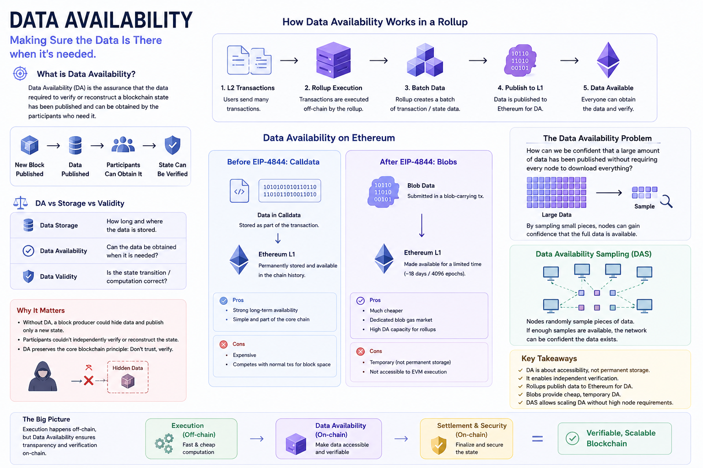

# Data Availability in Blockchain: How Networks Prove That Data Is Really There

A blockchain is supposed to be **verifiable without trusting a single party**.

When a new block changes the state of a blockchain, participants need enough information to independently verify that change.

This creates an important requirement:

> **The data needed to verify the blockchain must actually be available.**

This property is called **Data Availability (DA)**.

Data Availability has become especially important as blockchain architectures move toward separating **execution, settlement, and data availability**, particularly in Ethereum and its Layer 2 ecosystem.

---

## What Is Data Availability?

Data Availability is the assurance that the data required to independently verify a blockchain state transition has been **published and can be obtained by the participants who need it**.

A simple representation is:

```text
Block Published
      ↓
Required Data Published
      ↓
Participants Can Obtain It
      ↓
State Can Be Verified
```

The key word is **available**.

The protocol needs to provide confidence that the data was not secretly withheld by the block producer or another actor.

---

# Why Does a Blockchain Need Data Availability?

Imagine that a block producer claims:

```text
Previous State
      ↓
   Transactions
      ↓
New State
```

But instead of publishing the transactions, they publish only:

```text
New State Root
```

Other participants cannot reconstruct the path from the old state to the new state.

They would have to trust the producer.

That creates a fundamental problem:

```text
No Data
   ↓
No Independent Verification
   ↓
More Trust
   ↓
Weaker Trustlessness
```

Data Availability helps prevent this situation by ensuring the underlying data required for verification is actually obtainable.

Ethereum explicitly describes missing data as something that prevents nodes from independently verifying blocks.

---

# Data Availability Is Not the Same as Data Storage

This is one of the most important distinctions.

**Data storage** asks:

> Where is the data stored, and how long does it remain there?

**Data availability** asks:

> Can the required data be obtained when participants need it?

These are different properties.

For example:

```text
Permanent Storage
→ Data remains available long-term

Temporary Availability
→ Data is available for a defined period
```

This is why Ethereum can use temporary blob data for Rollups without making that data permanent blockchain state.

EIP-4844 blobs are designed with a limited lifetime rather than permanent storage. Ethereum currently describes the protocol guarantee for blob availability as roughly 18 days.

---

# Data Availability vs Data Validity

Another important distinction is between **availability** and **validity**.

These questions are different.

### Data Availability

> Can I obtain the data required to inspect or reconstruct the system?

### Data Validity

> Is the state transition or computation correct?

Conceptually:

```text
Data Availability
→ "Is the data there?"

Validity
→ "Is the computation correct?"
```

A system can have a valid proof while still facing a data availability problem.

This distinction becomes particularly important with ZK Rollups.

A validity proof can demonstrate that a state transition was computed correctly, but users still need access to relevant state data to interact with and understand the Rollup.

---

# The Data Availability Problem

The deeper challenge is not simply:

> "Can we publish the data?"

The challenge is:

> **How can a blockchain provide strong confidence that a large amount of data has been published without forcing every participant to download everything?**

This matters because blockchain scalability is constrained by resources such as:

* Bandwidth
* Storage
* Computation
* Network propagation

Suppose a block contains a very large amount of data.

If every node must download and process all of it, increasing data capacity also increases the hardware and bandwidth requirements for running nodes.

This creates a trade-off:

```text
More Data
    ↓
More DA Capacity
    ↓
Higher Node Requirements
    ↓
Potentially Less Accessibility
```

Modern Data Availability research tries to solve this problem.

---

# Data Availability in a Monolithic Blockchain

Traditional blockchains can use **on-chain data availability**.

A full node downloads the block data and independently verifies it.

If the data required to verify a block is missing, the node can reject the block rather than accepting an unverifiable state transition. Ethereum describes this as on-chain data availability.

The simplified model is:

```text
Block
 ↓
Full Node Downloads Data
 ↓
Execute / Verify
 ↓
Accept or Reject Block
```

The advantage is straightforward:

> The data needed for verification is directly part of the blockchain's normal data.

The disadvantage is that every node must handle the increasing data burden.

---

# Data Availability in Rollups

Rollups create a different architecture because execution happens outside Ethereum's main execution layer.

The Rollup can process many transactions and produce a new state.

But participants may still need access to the transaction or state data to independently interact with the system, reconstruct its state, or participate in its security model.

Therefore, the Rollup needs a mechanism for making that data available.

Conceptually:

```text
L2
 ↓
Execute Transactions
 ↓
Produce State Update
 ↓
Publish Required Data
 ↓
Data Availability Layer
```

For Ethereum Rollups, Ethereum itself can provide this availability through mechanisms such as calldata or blobs.

---

# Calldata as a Data Availability Mechanism

Before EIP-4844, Rollups commonly published transaction data using Ethereum's **calldata**.

Calldata becomes part of the permanent blockchain history.

This provides strong long-term availability, but it is expensive because the data competes for Ethereum block space and is processed by Ethereum nodes.

The model is:

```text
Rollup
  ↓
Transaction Data
  ↓
Calldata
  ↓
Ethereum
  ↓
Permanent Availability
```

This worked, but it was not an ideal long-term solution for large-scale Rollup data.

---

# EIP-4844 and Blob Data

EIP-4844 introduced **blobs**, creating a separate mechanism for publishing large amounts of data more cheaply.

The important difference is that blob data is not part of the permanent execution state and is only guaranteed to be available for a limited period.

Conceptually:

```text
Rollup
  ↓
Batch Data
  ↓
Blob
  ↓
Ethereum
  ↓
Temporary Data Availability
```

This makes blobs particularly useful for Rollup transaction data.

---

# Why Temporary Data Can Be Enough

At first, temporary data might sound unsafe.

Why not store the data forever?

Because the goal of Data Availability is not necessarily permanent storage.

Participants mainly need the data during the period in which it matters for:

* Verification
* Reconstruction
* Challenge mechanisms
* State synchronization

After that period, the protocol does not necessarily need to keep the complete raw data forever.

This allows Ethereum to provide a large amount of temporary data capacity without permanently increasing the historical storage burden at the same rate.

Ethereum currently specifies the blob retention period at 4096 epochs, roughly 18 days.

---

# Data Availability for Optimistic Rollups

Data Availability is especially important for Optimistic Rollups.

An Optimistic Rollup can submit a state update under the assumption that it is valid.

If someone detects an incorrect state transition, they may need the underlying transaction data to construct a fraud proof.

Therefore:

```text
Rollup State Update
        ↓
Data Must Be Available
        ↓
Someone Finds Invalid State
        ↓
Fraud Proof
        ↓
Invalid State Can Be Challenged
```

Without the necessary data, the challenge process may not work.

Ethereum's documentation explicitly notes that optimistic rollups need their transaction data available during the relevant challenge period.

---

# Data Availability for ZK Rollups

ZK Rollups work differently because they use validity proofs.

A proof can demonstrate:

```text
"The state transition was computed correctly."
```

But that does not automatically solve every data availability issue.

Users may still need access to state data to know their balances, reconstruct the Rollup state, or continue interacting with the system.

So:

```text
Validity Proof
→ Proves computation

Data Availability
→ Makes relevant state/data accessible
```

These solve different problems.

---

# KZG Commitments and Data Availability

Ethereum's blob system uses **KZG commitments**.

A blob is represented by a cryptographic commitment, allowing the protocol to associate the blob data with a compact cryptographic representation.

The conceptual flow is:

```text
Blob Data
    ↓
Polynomial Representation
    ↓
KZG Commitment
    ↓
Cryptographic Commitment
```

The commitment itself is not the entire blob.

It is a compact representation that can be used as part of the cryptographic verification mechanism.

EIP-4844 specifically introduced blob-carrying transactions where the large blob data is not accessible to EVM execution, while its commitment can be used by the protocol.

---

# What Is Data Availability Sampling?

One of the most important developments in Data Availability is **Data Availability Sampling (DAS)**.

The basic problem is:

```text
Huge Blob
   ↓
Do all nodes need to download everything?
```

DAS aims to provide confidence that the full data is available without requiring every node to download the entire dataset.

Instead, nodes can sample portions of the data.

Conceptually:

```text
Large Blob
 ├── Part A
 ├── Part B
 ├── Part C
 ├── Part D
 └── Part E

Node
 ↓
Randomly Sample Several Parts
 ↓
Verify Samples
 ↓
Gain Confidence That Data Is Available
```

Ethereum's PeerDAS design uses this approach so individual nodes can download only subsets of blob data while still gaining assurance about overall availability.

---

# Why Sampling Works

At first glance, checking only a few pieces may seem insufficient.

The key idea is that the data is structured using **erasure coding** and cryptographic commitments.

The protocol can transform the data into a form where missing portions can be detected through sampling.

The simplified idea is:

```text
Original Data
      ↓
Erasure Coding
      ↓
Many Data Pieces
      ↓
Random Sampling
      ↓
Detect Missing Data
```

If enough randomly selected pieces are available, the network can gain high confidence that the larger dataset was actually published.

This is an important technique for scaling Data Availability without requiring every node to process everything.

---

# Data Availability Sampling and Node Requirements

Without sampling:

```text
More Blob Data
      ↓
Every Node Downloads More
      ↓
Bandwidth Requirements Increase
```

With sampling:

```text
More Blob Data
      ↓
Nodes Download Small Samples
      ↓
Network Shares Verification Responsibility
```

This allows Ethereum to increase Data Availability capacity while trying to keep individual node requirements manageable.

PeerDAS is specifically designed to distribute this burden across the network.

---

# Availability Is a Network Property

Data Availability is not just a property of a file sitting on one server.

It is a property of the blockchain network's ability to make the data accessible in a **trust-minimized way**.

Consider two systems.

### System A

```text
One Server
   ↓
Stores Data
```

The data might physically exist, but users must trust that server to provide it.

### System B

```text
Decentralized Network
        ↓
Data Distributed
        ↓
Cryptographic Verification
```

Participants have stronger guarantees that the data exists and can be recovered without trusting a single entity.

This distinction is fundamental to decentralized Data Availability.

---

# Data Availability in Modular Blockchains

Modern blockchain architecture is increasingly becoming **modular**.

Instead of one blockchain doing everything, different components can specialize in:

```text
Execution
Settlement
Consensus
Data Availability
```

This allows systems to scale specific resources independently.

A simplified modular architecture is:

```text
              Blockchain Stack
                     │
       ┌─────────────┼─────────────┐
       ↓             ↓             ↓
   Execution      Settlement       DA
       │             │             │
   Transactions    Security      Data
```

Layer 2 Rollups are one example of this broader architectural direction.

---

# Why Data Availability Is Different From a Data Availability Layer

The term **Data Availability** describes a property.

A **Data Availability Layer (DAL)** is infrastructure specifically designed to provide that property.

So:

```text
Data Availability
→ The guarantee / property

Data Availability Layer
→ Infrastructure that provides the guarantee
```

Ethereum itself provides Data Availability for certain types of data.

Other blockchain ecosystems can also build specialized DA systems.

---

# Why Data Availability Matters for Blockchain Security

Data Availability directly affects how independently participants can verify a system.

The relationship can be simplified as:

```text
Data Available
      ↓
Independent Verification
      ↓
Less Trust Required
      ↓
Stronger Security Model
```

If important data can be withheld, participants may become dependent on trusted operators.

Therefore, Data Availability is not merely a performance feature.

It is part of the **trust model** of a blockchain system.

---

# Data Availability and Scalability

There is an interesting relationship between scalability and Data Availability.

A blockchain wants:

```text
More Data
+
More Transactions
+
Low Node Requirements
```

But increasing data creates additional network costs.

Data Availability research therefore tries to maximize:

```text
DA Capacity
```

while minimizing:

```text
Per-Node Data Burden
```

This is why techniques such as blobs, erasure coding, and data availability sampling are important.

---

# The Ethereum Approach

Ethereum's scaling architecture increasingly treats **data availability as a resource separate from execution**.

EIP-4844 introduced blobs and a separate blob fee market, giving Rollups a cheaper way to publish data.

Ethereum's longer-term scaling work continues to focus on increasing blob capacity while keeping node requirements manageable through technologies such as Data Availability Sampling.

The direction can be summarized as:

```text
More Rollup Activity
        ↓
More Data Required
        ↓
More Blob Capacity
        ↓
Data Availability Scaling
        ↓
More Ethereum L2 Throughput
```

---

# A Simple Example

Imagine a Rollup processes 10,000 transactions.

The Rollup produces a new state.

To allow participants to verify or reconstruct the state, relevant transaction/state data must be available.

The process can look like:

```text
10,000 L2 Transactions
          ↓
     Rollup Execution
          ↓
      Batch Data
          ↓
         Blob
          ↓
      Ethereum
          ↓
Data Availability
          ↓
Independent Participants
          ↓
Verify / Reconstruct State
```

The key part is not that Ethereum executes all 10,000 transactions.

The key part is that the data necessary for the Rollup's operation is made available through Ethereum's infrastructure.

---

# The Bigger Picture

Data Availability connects several important blockchain concepts:

```text
                    Blockchain
                        │
          ┌─────────────┼─────────────┐
          ↓             ↓             ↓
      Execution      Settlement      DA
          │             │             │
      Compute       Finalize       Publish Data
          │                           │
          └──────────────┬────────────┘
                         ↓
                      Rollups
                         ↓
                  Ethereum Scaling
```

This separation allows a blockchain ecosystem to increase transaction capacity without forcing every node to perform every task at the same scale.

---

# Key Takeaways

The most important ideas to remember are:

```text
Data Availability
→ Data required for verification is accessible.

Data Storage
→ How and where data is retained.

Data Validity
→ Whether a state transition is correct.

Calldata
→ Permanent Ethereum transaction data.

Blobs
→ Temporary data-availability mechanism.

KZG Commitment
→ Cryptographic commitment to blob data.

DAS
→ Verify availability by sampling data.
```

Once these concepts are connected, Ethereum's modern scaling architecture becomes much easier to understand.

---

# Conclusion

**Data Availability is the guarantee that the data needed to independently verify or reconstruct a blockchain state is actually available.**

It is different from permanent storage and different from proving computational validity.

For Ethereum, Data Availability has become particularly important because Layer 2 systems can perform execution outside the main chain while still relying on Ethereum to make necessary data available.

EIP-4844 introduced blobs as a cheaper, temporary mechanism for publishing Rollup data, while newer technologies such as **Data Availability Sampling** aim to increase capacity without requiring every node to download every piece of data.

The core idea is simple:

> **A blockchain cannot be truly trustless if the data required to verify its state can simply be withheld.**

That is why Data Availability is one of the foundational concepts behind Ethereum's modern scaling architecture.
