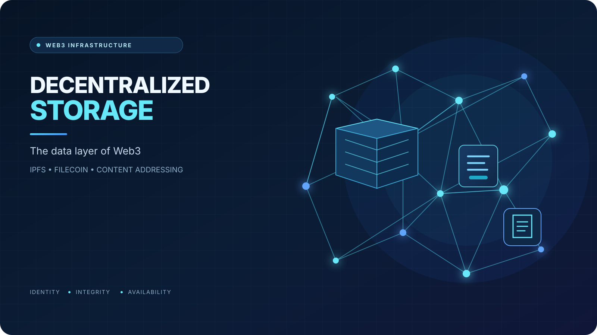
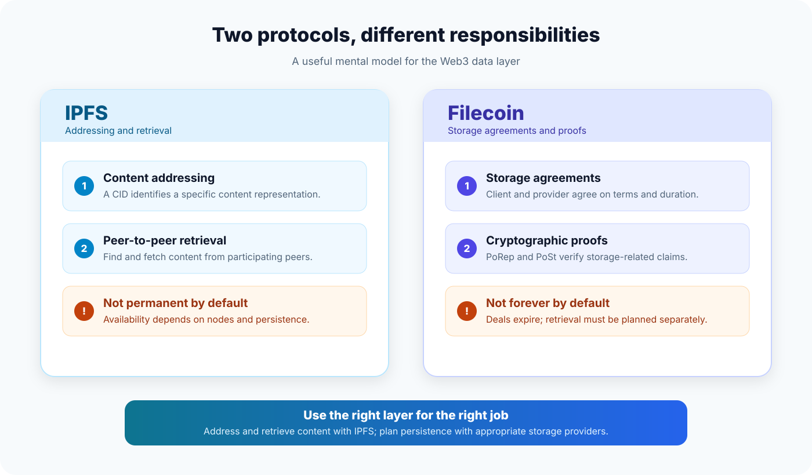
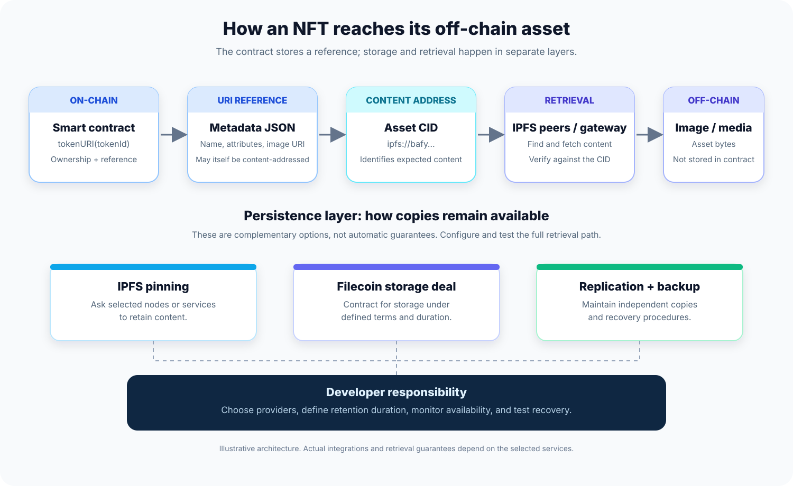
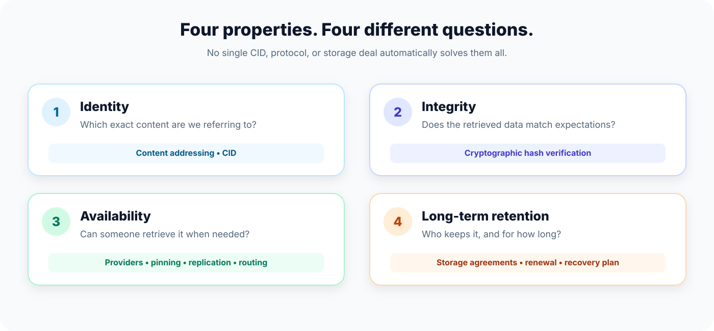

# Decentralized Storage Explained: IPFS, Filecoin, and the Data Layer of Web3

*How content addressing, distributed networks, and cryptographic proofs are changing the way we store data on the internet.*

## Introduction: What Happens to Web3 When the Server Goes Down?

Imagine you mint an NFT, deploy a smart contract, and store its metadata on a traditional cloud server.

Your smart contract is still running on the blockchain. The token still exists. Its ownership records are still verifiable.

But one day, the server hosting the NFT image disappears.

The token remains on-chain, yet its image may no longer load.

This illustrates an important architectural problem in Web3: **decentralizing ownership and execution does not automatically decentralize data storage.**

Blockchains are excellent at maintaining shared state, executing deterministic logic, and verifying transactions. However, storing large files directly on-chain is generally expensive and inefficient.

Images, videos, documents, application assets, and large datasets need a different approach.

This is where **decentralized storage** becomes important.

Technologies such as the InterPlanetary File System (IPFS) and Filecoin offer different but complementary building blocks for storing, addressing, distributing, and maintaining data without relying entirely on a single storage provider.

To understand why they matter, we first need to understand what decentralized storage actually changes.

## 1. What Is Decentralized Storage?

Decentralized storage is an approach in which data can be stored, distributed, or retrieved through a network of independent participants rather than depending exclusively on one company's infrastructure.

In a conventional cloud architecture, an application may depend on a particular provider to store files and make them available. The provider manages the underlying infrastructure, and the application generally accesses data through that provider's APIs.

This model is convenient, but it can introduce dependencies on a single company, account, region, or service.

Decentralized storage takes a different approach.

Data may be held by multiple independent nodes or storage providers. Depending on the system, users can identify content by its data-derived identifier, replicate it across different operators, and use cryptographic mechanisms to verify aspects of its integrity or storage.

The goal is not simply to put files on multiple computers. It is to reduce unnecessary dependence on a single operator and create a more resilient data layer.

However, decentralization does not automatically guarantee that every file will always be available. That requires additional mechanisms, such as persistent storage, replication, incentives, and reliable retrieval.

This distinction is essential: **storing data, identifying data, verifying data, and guaranteeing access to data are different problems.**

Different protocols solve different parts of that problem.

## 2. IPFS: Finding Data by What It Is

IPFS stands for the **InterPlanetary File System**.

It is a set of open protocols for addressing, routing, and transferring content across a peer-to-peer network. Rather than relying exclusively on a file's location, IPFS uses *content addressing*.

Consider a traditional URL:

**https://example.com/images/nft.png**

This address tells your application where to request the file. If the server disappears or the file is moved, that URL may stop working.

IPFS introduces a different model.

Instead of identifying content only by its location, IPFS uses a **Content Identifier (CID)** associated with the content and its representation.

A simplified example looks like this:

**ipfs://bafy...**

The CID allows a client to request particular content without tying its identity to a single server address.

### How content addressing works

At a high level, the process looks like this:

**1. A file is added to IPFS.**

The file is processed into content-addressed blocks. Larger files can be divided into smaller blocks, which are organized into a structure linking the pieces together.

**2. A CID is generated.**

The CID identifies the resulting content structure. It incorporates a cryptographic hash and information about how the content is represented.

**3. The content can be requested by its CID.**

An IPFS node uses network discovery and retrieval mechanisms to find peers that can provide the requested data.

**4. The retrieved content can be verified.**

Because the identifier is tied to the content, a client can verify that the retrieved data matches the expected identifier.

This gives IPFS an important property: the address is based on the content, not simply on the server that happens to host it.

If the content changes, its CID will generally change as well.

### Why does that matter?

Suppose a decentralized application references an image through IPFS.

With a conventional location-based URL, the application depends on the continued availability of a particular location.

With a CID, the application can retrieve the same content from different locations, provided that the content remains available and the necessary network and retrieval paths continue to work.

This is particularly valuable for public datasets, NFT assets, decentralized websites, application metadata, and files that need to be independently verifiable.

But there is a crucial limitation.

**IPFS does not automatically guarantee permanent storage.**

IPFS is a protocol and network for addressing and transferring content. It is not, by itself, a service that promises to preserve every uploaded file indefinitely.

IPFS nodes may cache content temporarily. If a node removes content that it no longer needs, that node may stop serving it.

To maintain availability, developers need an appropriate persistence strategy.

Two important options are pinning and incentive-backed storage.

## 3. Pinning: Keeping Content Available

Pinning tells an IPFS node to retain particular content instead of allowing it to be removed through ordinary garbage collection.

For example, a developer can pin an application's metadata and images to a local IPFS node or use a third-party pinning service.

This is useful because content that remains pinned can continue to be served by that node.

However, pinning is not the same as permanent, decentralized storage.

If the only provider holding a pinned file shuts down, deletes the file, or stops participating, availability may be lost.

A pinning service can also operate on conventional centralized infrastructure. Using IPFS does not automatically mean that every part of the storage arrangement is decentralized.

For applications that need long-term persistence, developers should consider multiple independent copies, different providers, monitoring, backup and recovery procedures, and the possibility of renewing storage arrangements.

The important question is not merely:

*Is this file on IPFS?*

It is:

*Who is responsible for keeping this file available, for how long, and what happens if they stop?*

This brings us to Filecoin.

## 4. Filecoin: Adding Storage Incentives and Verifiability

Filecoin is a decentralized storage network that enables clients to obtain storage from storage providers under defined agreements.

Where IPFS focuses on content addressing and data transfer, Filecoin adds an economic and cryptographic framework for storage.

Think of the distinction this way:

- **IPFS helps applications address and retrieve content across a peer-to-peer network.**
- **Filecoin provides a network in which storage providers can offer storage under agreements and prove that they are meeting specified storage obligations.**

The technologies can be used together, but they are not interchangeable.

IPFS does not require Filecoin to function, and Filecoin's storage services are not simply another name for IPFS.

### How Filecoin storage works

A simplified storage workflow looks like this:

**1. A client selects a storage provider.**

The client evaluates available providers and the terms they offer.

**2. The client and provider agree on storage terms.**

A storage agreement can specify details such as the data, duration, price, and collateral arrangements.

**3. The provider stores the data.**

The provider commits resources to maintaining the agreed data.

**4. The network verifies storage-related claims.**

Filecoin uses cryptographic proof mechanisms to check storage commitments.

Two important concepts are Proof of Replication (PoRep) and Proof of Spacetime (PoSt).

Proof of Replication is used to demonstrate that a provider has created a distinct encoded replica of data. Proof of Spacetime is used to demonstrate, over time, that the provider continues to store data according to the protocol's requirements.

These mechanisms help make storage commitments verifiable rather than relying entirely on a provider's unsupported assertion.

They do not eliminate every possible storage risk. Developers still need to understand the storage deal, its duration, retrieval arrangements, and how they will respond to failures or expiration.

### Does Filecoin guarantee that data will exist forever?

No.

Filecoin storage arrangements have defined terms. A developer must understand how long the data is contracted to be stored and what happens when that period ends.

Long-term availability requires an appropriate strategy, which may include renewing storage, arranging additional copies, or using multiple independent providers.

Filecoin makes storage commitments economically and cryptographically verifiable. It should not be treated as a universal guarantee of perpetual availability.

That distinction is particularly important when the data is critical to an application.

## 5. IPFS and Filecoin: Different Roles, One Architecture

IPFS and Filecoin are often mentioned together because they address complementary needs in decentralized storage.

Imagine building an NFT marketplace.

The smart contract manages token ownership. The application's metadata and images are stored off-chain. Those files need identifiers that applications can reference, and they also need a plan for staying available.

A simplified architecture might look like this:

**NFT Smart Contract**  
↓  
**Token URI or Metadata Reference**  
↓  
**IPFS CID**  
↓  
**IPFS-compatible retrieval**  
↓  
**Content stored by participating nodes or storage providers**

A separate persistence layer can use IPFS pinning, Filecoin storage deals, or other suitable storage services to help maintain access to that content.

In this architecture, IPFS helps identify and retrieve the content, while Filecoin can provide storage agreements and proofs designed to support longer-term data retention.

The exact integration depends on the storage service and workflow. Not every Filecoin deal is automatically available through every IPFS gateway, and developers should verify the retrieval path for their chosen provider.

### Why not store everything directly on-chain?

Blockchain storage offers strong guarantees within the blockchain's execution and consensus model, but it is usually unsuitable for large files because of cost and scalability constraints.

A more practical architecture separates responsibilities:

- **On-chain:** ownership, permissions, financial state, critical application logic, and compact references.
- **Off-chain storage:** images, videos, documents, metadata, and larger datasets.
- **Application layer:** interfaces, APIs, indexing, and retrieval logic.

In this design, the blockchain can store a content reference, such as a CID, while the actual file remains off-chain.

The application can then retrieve the file and verify its integrity against the expected content identifier.

This separation allows developers to build data-rich applications without trying to force every byte into the blockchain.

## 6. Why Decentralized Storage Matters for Web3 Developers

Decentralized storage is not just infrastructure for storing NFT images. It influences the architecture of many kinds of applications.

### NFTs and digital ownership

NFTs often reference metadata that points to images, animations, or other assets.

If those assets depend entirely on a single traditional server, the experience associated with the token may disappear even though the token itself continues to exist.

Using content-addressed storage and a well-designed persistence strategy can reduce this dependency.

However, the developer must distinguish between the token's on-chain existence and the continued availability of the content it references.

### Decentralized applications

A decentralized application may need to distribute frontend assets, documentation, configuration files, public datasets, or user-generated content.

IPFS can provide a content-addressed distribution mechanism, while pinning and other storage arrangements help keep essential content available.

The frontend still needs a way for users to discover and access it. Gateways, domain resolution, and application hosting can introduce additional dependencies, even when the underlying content is stored on a decentralized network.

### Decentralized governance

Governance protocols sometimes publish proposals, supporting documents, and voting information outside the blockchain.

Keeping important public materials available and giving them stable, verifiable identifiers can help improve transparency and make it easier for participants to reference the same documents.

The precise storage requirements depend on the governance system and the importance of preserving historical records.

### Data for AI and research

Large datasets can be expensive to store on-chain and may need to be made available to multiple users or applications.

Decentralized storage networks can offer an alternative way to distribute datasets, archives, and other large files.

For AI-related projects, however, storage is only one part of the problem. Data provenance, integrity, licensing, privacy, retrieval performance, and dataset versioning remain important.

## 7. The Limitations Developers Must Understand

Decentralized storage solves meaningful problems, but it introduces engineering decisions that are easy to overlook.

### Availability is not the same as integrity

A CID allows content to be verified against an expected identifier. It does not guarantee that a peer currently has the data or that a retrieval request will succeed.

A file can be perfectly verifiable yet temporarily or permanently unavailable.

Production systems need persistence planning, redundancy, monitoring, and recovery procedures.

### Decentralization can be incomplete

An application may use IPFS while depending on one pinning company or one gateway for everyday access.

That architecture may be more flexible than storing everything on a single conventional server, but it can still contain centralized failure points.

Developers should examine the entire stack rather than treating a protocol name as proof that an application is fully decentralized.

### Retrieval performance can vary

Data retrieval depends on which providers hold the content, network conditions, routing, and the retrieval mechanisms being used.

A decentralized network does not automatically offer lower latency or more predictable performance than a conventional content delivery network.

Many applications will need caching, gateways, replication, or other performance optimizations.

### Public data is not private data

IPFS is not a privacy layer by default.

Unless content is encrypted, people who obtain the relevant CID may be able to retrieve and read the content. Network metadata can also reveal information about participating nodes and the content they advertise.

Developers should never assume that an obscure CID acts as a secret access-control mechanism.

Sensitive data should be encrypted before being stored, with access-control and key-management mechanisms designed separately. Even then, encryption does not automatically hide all metadata or network activity.

### Mutability requires additional design

Content addressing creates a useful relationship between an identifier and a particular version of content.

When that content changes, the CID will generally change too.

This is beneficial for integrity, but applications that need mutable names or changing content must manage a pointer to the latest version. IPNS and DNSLink are examples of mechanisms used to create naming or linking layers around IPFS content.

Developers also need to decide whether a smart contract should permit its metadata reference to change. That is an application-level trust and governance decision, not something that IPFS decides on its own.

## 8. A Practical Checklist for Smart Contract Developers

When designing a smart contract that references off-chain data, consider these questions before deployment.

**1. What exactly belongs on-chain?**

Store the state that requires blockchain guarantees on-chain. Keep large media files and other bulky assets off-chain unless there is a compelling reason to do otherwise.

**2. How will the application identify the content?**

Understand CIDs and the difference between a content identifier and a conventional URL. Verify that your application handles the intended URI format correctly.

**3. Who will maintain the content?**

Decide whether to operate an IPFS node, use one or more pinning services, arrange storage with providers, or combine these approaches.

**4. What happens if one provider disappears?**

Plan for redundancy and recovery. For important content, avoid relying on a single copy or an undocumented dependency.

**5. How long must the data remain available?**

Match storage arrangements to the application's expected lifetime. Account for expiration, renewal, provider failure, and migration.

**6. Is the data public or sensitive?**

Treat content stored on public decentralized networks as public unless it has been properly encrypted. Design key management and authorization separately.

**7. How will users retrieve the data?**

Test the complete path from the contract's reference to the actual content. A valid CID alone does not guarantee fast or successful retrieval.

**8. Can the reference change?**

Decide whether metadata is immutable, updateable by an authorized party, or governed by a more complex mechanism. Make those rules explicit to users.

These decisions are part of smart contract and application architecture—not minor details to postpone until after deployment.

## Conclusion: Web3 Needs More Than Decentralized Execution

Blockchain technology has changed how applications can manage ownership, shared state, and execution without relying on a single trusted database operator.

But a decentralized application is only as robust as the broader system on which it depends.

If its smart contracts are decentralized while its critical files rely entirely on one server, an important part of the application can still remain fragile.

Decentralized storage addresses this gap by separating content from a single location and providing alternative ways to distribute, verify, and maintain data.

IPFS introduces content addressing and peer-to-peer retrieval. Filecoin adds a market and cryptographic mechanisms for storage commitments. Pinning, replication, redundancy, retrieval infrastructure, and sensible application design help turn these building blocks into a usable storage architecture.

Neither technology makes every file permanent or every application fully decentralized by default.

The real value comes from understanding the responsibilities of each layer and designing them to work together.

**For Web3 developers, decentralized storage is not merely a place to upload files. It is a fundamental part of designing applications whose data can remain verifiable, accessible, and resilient beyond the lifetime of a single server.**

---

## Further Reading

For readers who want to explore the underlying protocols, these official resources are good starting points:

- [IPFS Documentation — What Is IPFS?](https://docs.ipfs.tech/concepts/what-is-ipfs/)
- [IPFS Documentation — How IPFS Works](https://docs.ipfs.tech/concepts/how-ipfs-works/)
- [IPFS Documentation — Content Identifiers (CIDs)](https://docs.ipfs.tech/concepts/content-addressing/)
- [IPFS Documentation — Persistence, Permanence, and Pinning](https://docs.ipfs.tech/concepts/persistence/)
- [IPFS Documentation — Privacy and Encryption](https://docs.ipfs.tech/concepts/privacy-and-encryption/)
- [Filecoin — Learn About the Network](https://www.filecoin.io/learn)
- [Filecoin Documentation — Storage Model](https://github.com/filecoin-project/filecoin-docs/blob/main/getting-started/what-is-filecoin/storage-model.md)
- [Ethereum.org — Decentralized Storage](https://ethereum.org/developers/docs/storage)

*This article is intended for educational purposes. Specific storage guarantees, costs, deal terms, and retrieval behavior depend on the protocol and services selected.*
